# 盲盒小智一期演示机器人平台

本仓库是在 GitHub 开源项目 `xiaozhi-esp32` 基础上扩展的一期演示机器人项目。当前目标不是先做量产成品，而是做一个可以现场演示的自研平台闭环：

- ESP32-S3 机器人硬件继续复用小智语音交互能力。
- 自研 Django 后端负责设备、角色、景点、GPS、NFC、对话记录、官网同步状态等数据。
- 自研 React 前端负责演示管理台，让设备在线、角色配置、GPS/NFC 打卡、对话记录等信息可视化。
- 硬件未完全接好时，可以用 `tools/device_simulator/` 模拟设备心跳、GPS 接近、NFC 打卡。
- 一期允许小智官网继续承担真实语音链路，但角色提示词、音色、知识引用、同步状态和对话留痕需要在自研平台体现。

## 当前一期演示范围

P0 演示链路：

1. 管理员登录自研平台。
2. 查看演示设备 `device_001` 在线状态。
3. 查看或配置角色智能体、景点、NFC 标签、知识数据集。
4. ESP32 或设备模拟器向后端上报心跳、GPS、NFC。
5. 前端展示设备状态、GPS/NFC 打卡结果。
6. 平台展示对话记录、官网同步状态、官网同步快照。

默认演示账号：

```text
账号：root
密码：root
```

默认演示设备：

```text
device_id：device_001
device_token：demo-device-token
```

注意：`device_token` 只用于本地一期演示，不要提交真实生产 token。

## 项目目录

```text
main/                    小智 ESP32 固件主体
backend/                 Django + DRF + PostgreSQL 后端
frontend/                React + Vite + Ant Design 前端
tools/device_simulator/  设备模拟器，模拟心跳、GPS、NFC
deploy/                  部署示例、Nginx/Gunicorn/env 说明
docs/blindbox_project/   一期产品、架构、研发、测试、硬件文档
scripts/                 本地启动脚本
```

## 一键启动本地演示

Windows PowerShell 下在仓库根目录执行：

```powershell
cd D:\mysterybox\xiaozhi-esp32-main
.\scripts\start_local_demo.ps1
```

启动后打开：

```text
前端：http://127.0.0.1:5173
后端：http://127.0.0.1:8000
登录：root / root
```

如果想启动后顺便跑一次虚拟 GPS/NFC 流程：

```powershell
cd D:\mysterybox\xiaozhi-esp32-main
.\scripts\start_local_demo.ps1 -RunSimulator
```

如果不想重新写入演示数据：

```powershell
cd D:\mysterybox\xiaozhi-esp32-main
.\scripts\start_local_demo.ps1 -SkipSeed
```

## 后端服务单独启动

如果只想启动后端，按下面步骤执行。

第一步，启动项目内置 PostgreSQL：

```powershell
cd D:\mysterybox\xiaozhi-esp32-main
tmp\pgextract\pgsql\bin\pg_ctl.exe -D tmp\pgdata -l tmp\pg.log start
tmp\pgextract\pgsql\bin\pg_isready.exe -h 127.0.0.1 -p 5432 -U postgres
```

第二步，迁移数据库并写入演示数据：

```powershell
cd D:\mysterybox\xiaozhi-esp32-main\backend
.\.venv\Scripts\python.exe manage.py migrate --noinput
.\.venv\Scripts\python.exe manage.py seed_demo
```

第三步，启动 Django 后端：

```powershell
cd D:\mysterybox\xiaozhi-esp32-main\backend
.\.venv\Scripts\python.exe manage.py runserver 127.0.0.1:8000
```

本机浏览器访问：

```text
http://127.0.0.1:8000/api/v1/demo/overview
```

如果 ESP32 真机要访问后端，不能使用 `127.0.0.1`，必须使用电脑局域网 IP：

```powershell
ipconfig
cd D:\mysterybox\xiaozhi-esp32-main\backend
.\.venv\Scripts\python.exe manage.py runserver 0.0.0.0:8000
```

假设电脑局域网 IP 是 `192.168.1.9`，ESP32 使用：

```text
http://192.168.1.9:8000/api/v1
```

设备接口 smoke test：

```powershell
curl.exe -H "X-Device-Id: device_001" -H "X-Device-Token: demo-device-token" "http://127.0.0.1:8000/api/v1/device-config?device_id=device_001"

curl.exe -X POST "http://127.0.0.1:8000/api/v1/device-heartbeats" -H "Content-Type: application/json" -H "X-Device-Id: device_001" -H "X-Device-Token: demo-device-token" -d "{\"device_id\":\"device_001\",\"firmware_version\":\"local-smoke\",\"battery_percent\":100}"
```

## 前端服务单独启动

```powershell
cd D:\mysterybox\xiaozhi-esp32-main\frontend
npm install
npm run dev
```

打开：

```text
http://127.0.0.1:5173
```

构建验证：

```powershell
cd D:\mysterybox\xiaozhi-esp32-main\frontend
npm run build
```

## 设备模拟器

硬件未完全接好时，可以先用模拟器验证软件闭环：

```powershell
cd D:\mysterybox\xiaozhi-esp32-main\tools\device_simulator
python simulate_device.py --base-url http://127.0.0.1:8000/api/v1 --device-id device_001 --device-token demo-device-token --admin-username root --admin-password root flow --gps-count 2 --interval 1
```

模拟器会模拟：

- 拉取设备配置。
- 上报设备心跳。
- 上报 GPS 接近事件。
- 上报 NFC 打卡。

## 常见问题

### 1. 后端启动失败，提示 PostgreSQL 连不上

先确认 PostgreSQL 是否启动：

```powershell
cd D:\mysterybox\xiaozhi-esp32-main
tmp\pgextract\pgsql\bin\pg_isready.exe -h 127.0.0.1 -p 5432 -U postgres
```

如果没有启动，执行：

```powershell
tmp\pgextract\pgsql\bin\pg_ctl.exe -D tmp\pgdata -l tmp\pg.log start
```

### 2. ESP32 访问不到后端

检查三点：

- Django 是否用 `0.0.0.0:8000` 启动。
- ESP32 配置的后端地址是否是电脑局域网 IP，不是 `127.0.0.1`。
- Windows 防火墙是否允许 8000 端口局域网访问。

### 3. 前端能打开但没有数据

先执行：

```powershell
cd D:\mysterybox\xiaozhi-esp32-main\backend
.\.venv\Scripts\python.exe manage.py seed_demo
```

然后刷新前端页面。

## 重要文档入口

- [项目文档索引](docs/blindbox_project/README.md)
- [研发模块责任分工](docs/blindbox_project/development_task_ownership.md)
- [Web API 契约](docs/blindbox_project/web_api_contract.md)
- [测试与质量门](docs/blindbox_project/testing_and_quality.md)
- [发布与运维手册](docs/blindbox_project/release_operations_runbook.md)
- [硬件接线手册](docs/blindbox_project/phase1_hardware_wiring_manual.md)

---

下面保留小智上游项目原 README，作为固件和小智生态资料入口。

# An MCP-based Chatbot

(English | [中文](README_zh.md) | [日本語](README_ja.md))

## Introduction

👉 [Human: Give AI a camera vs AI: Instantly finds out the owner hasn't washed hair for three days【bilibili】](https://www.bilibili.com/video/BV1bpjgzKEhd/)

👉 [Handcraft your AI girlfriend, beginner's guide【bilibili】](https://www.bilibili.com/video/BV1XnmFYLEJN/)

As a voice interaction entry, the XiaoZhi AI chatbot leverages the AI capabilities of large models like Qwen / DeepSeek, and achieves multi-terminal control via the MCP protocol.


## Version Notes

The current v2 version is incompatible with the v1 partition table, so it is not possible to upgrade from v1 to v2 via OTA. For partition table details, see [partitions/v2/README.md](partitions/v2/README.md).

All hardware running v1 can be upgraded to v2 by manually flashing the firmware.

The stable version of v1 is 1.9.2. You can switch to v1 by running `git checkout v1`. The v1 branch will be maintained until February 2026.

### Features Implemented

- Wi-Fi / ML307 Cat.1 4G
- Offline voice wake-up [ESP-SR](https://github.com/espressif/esp-sr)
- Supports two communication protocols ([Websocket](docs/websocket.md) or MQTT+UDP)
- Uses OPUS audio codec
- Voice interaction based on streaming ASR + LLM + TTS architecture
- Speaker recognition, identifies the current speaker [3D Speaker](https://github.com/modelscope/3D-Speaker)
- OLED / LCD display, supports emoji display
- Battery display and power management
- Multi-language support (Chinese, English, Japanese)
- Supports ESP32-C3, ESP32-S3, ESP32-P4 chip platforms
- Device-side MCP for device control (Speaker, LED, Servo, GPIO, etc.)
- Cloud-side MCP to extend large model capabilities (smart home control, PC desktop operation, knowledge search, email, etc.)
- Customizable wake words, fonts, emojis, and chat backgrounds with online web-based editing ([Custom Assets Generator](https://github.com/78/xiaozhi-assets-generator))

## Hardware

### Breadboard DIY Practice

See the Feishu document tutorial:

👉 ["XiaoZhi AI Chatbot Encyclopedia"](https://ccnphfhqs21z.feishu.cn/wiki/F5krwD16viZoF0kKkvDcrZNYnhb?from=from_copylink)

Breadboard demo:

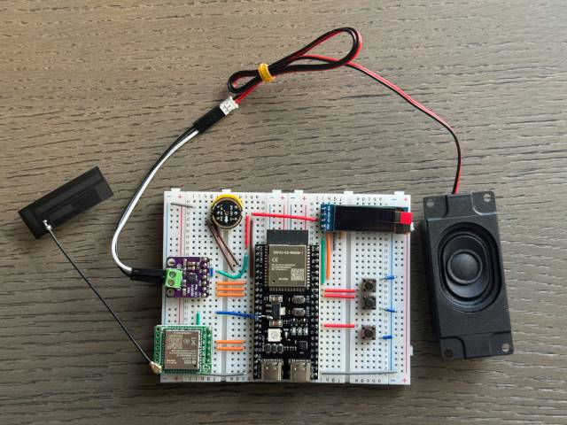

### Supports 70+ Open Source Hardware (Partial List)

- <a href="https://oshwhub.com/li-chuang-kai-fa-ban/li-chuang-shi-zhan-pai-esp32-s3-kai-fa-ban" target="_blank" title="LiChuang ESP32-S3 Development Board">LiChuang ESP32-S3 Development Board</a>
- <a href="https://github.com/espressif/esp-box" target="_blank" title="Espressif ESP32-S3-BOX3">Espressif ESP32-S3-BOX3</a>
- <a href="https://docs.m5stack.com/zh_CN/core/CoreS3" target="_blank" title="M5Stack CoreS3">M5Stack CoreS3</a>
- <a href="https://docs.m5stack.com/en/atom/Atomic%20Echo%20Base" target="_blank" title="AtomS3R + Echo Base">M5Stack AtomS3R + Echo Base</a>
- <a href="https://gf.bilibili.com/item/detail/1108782064" target="_blank" title="Magic Button 2.4">Magic Button 2.4</a>
- <a href="https://www.waveshare.net/shop/ESP32-S3-Touch-AMOLED-1.8.htm" target="_blank" title="Waveshare ESP32-S3-Touch-AMOLED-1.8">Waveshare ESP32-S3-Touch-AMOLED-1.8</a>
- <a href="https://github.com/Xinyuan-LilyGO/T-Circle-S3" target="_blank" title="LILYGO T-Circle-S3">LILYGO T-Circle-S3</a>
- <a href="https://oshwhub.com/tenclass01/xmini_c3" target="_blank" title="XiaGe Mini C3">XiaGe Mini C3</a>
- <a href="https://oshwhub.com/movecall/cuican-ai-pendant-lights-up-y" target="_blank" title="Movecall CuiCan ESP32S3">CuiCan AI Pendant</a>
- <a href="https://github.com/WMnologo/xingzhi-ai" target="_blank" title="WMnologo-Xingzhi-1.54">WMnologo-Xingzhi-1.54TFT</a>
- <a href="https://www.seeedstudio.com/SenseCAP-Watcher-W1-A-p-5979.html" target="_blank" title="SenseCAP Watcher">SenseCAP Watcher</a>
- <a href="https://www.bilibili.com/video/BV1BHJtz6E2S/" target="_blank" title="ESP-HI Low Cost Robot Dog">ESP-HI Low Cost Robot Dog</a>

<div style="display: flex; justify-content: space-between;">
  <a href="docs/v1/lichuang-s3.jpg" target="_blank" title="LiChuang ESP32-S3 Development Board">
    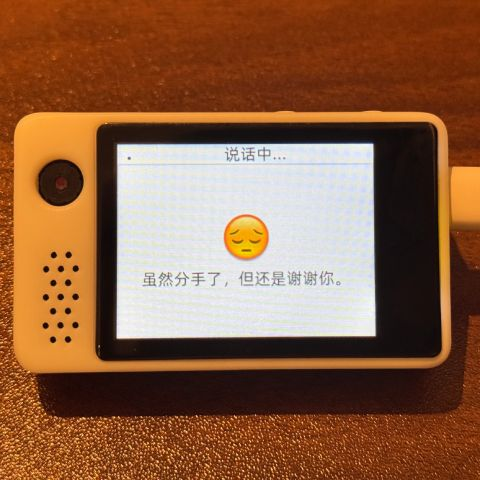
  </a>
  <a href="docs/v1/espbox3.jpg" target="_blank" title="Espressif ESP32-S3-BOX3">
    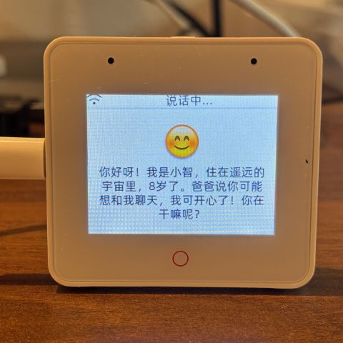
  </a>
  <a href="docs/v1/m5cores3.jpg" target="_blank" title="M5Stack CoreS3">
    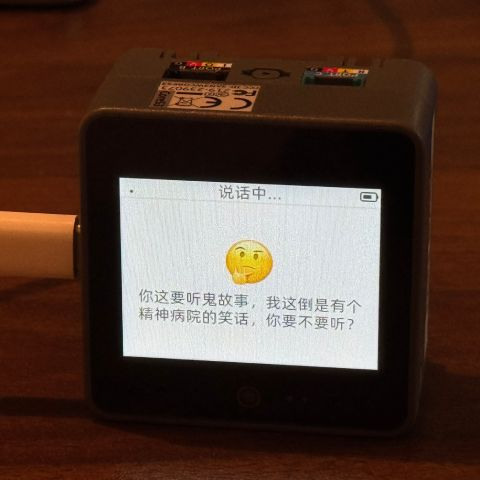
  </a>
  <a href="docs/v1/atoms3r.jpg" target="_blank" title="AtomS3R + Echo Base">
    
  </a>
  <a href="docs/v1/magiclick.jpg" target="_blank" title="Magic Button 2.4">
    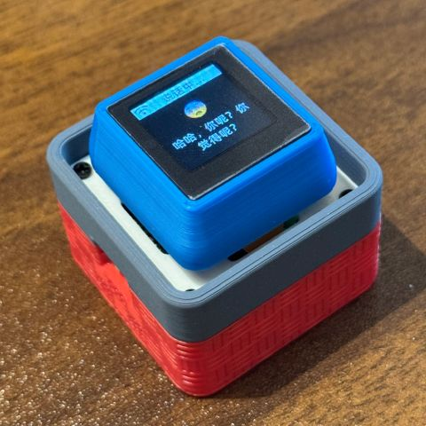
  </a>
  <a href="docs/v1/waveshare.jpg" target="_blank" title="Waveshare ESP32-S3-Touch-AMOLED-1.8">
    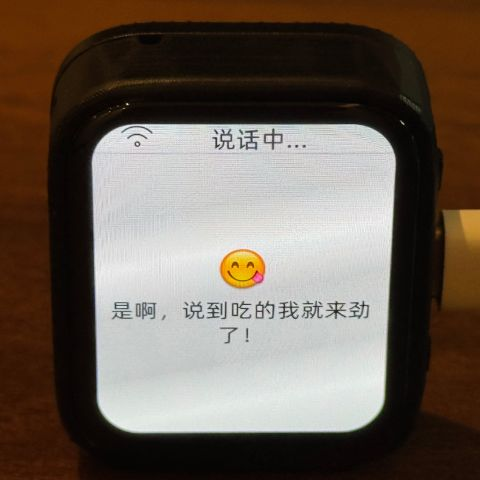
  </a>
  <a href="docs/v1/lilygo-t-circle-s3.jpg" target="_blank" title="LILYGO T-Circle-S3">
    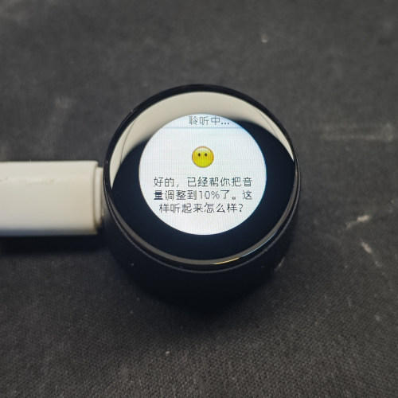
  </a>
  <a href="docs/v1/xmini-c3.jpg" target="_blank" title="XiaGe Mini C3">
    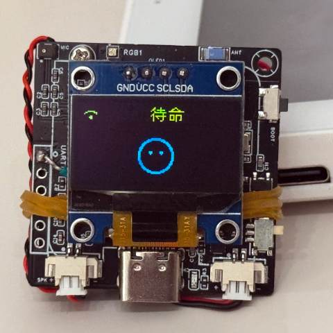
  </a>
  <a href="docs/v1/movecall-cuican-esp32s3.jpg" target="_blank" title="CuiCan">
    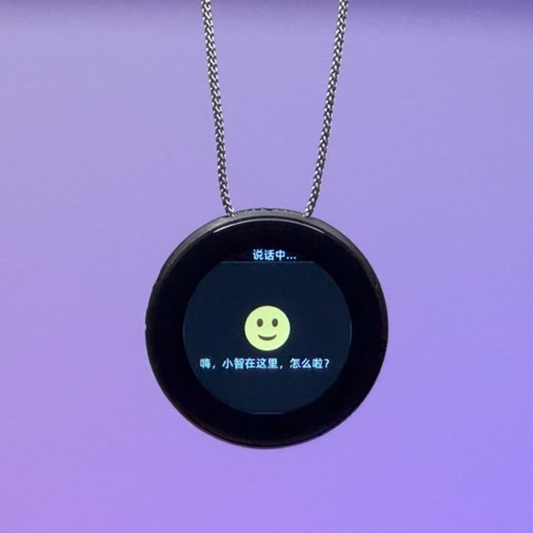
  </a>
  <a href="docs/v1/wmnologo_xingzhi_1.54.jpg" target="_blank" title="WMnologo-Xingzhi-1.54">
    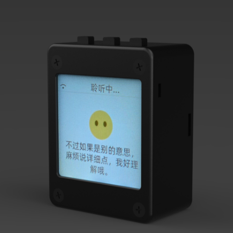
  </a>
  <a href="docs/v1/sensecap_watcher.jpg" target="_blank" title="SenseCAP Watcher">
    
  </a>
  <a href="docs/v1/esp-hi.jpg" target="_blank" title="ESP-HI Low Cost Robot Dog">
    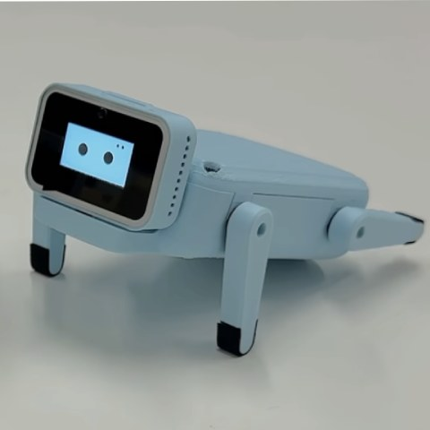
  </a>
</div>

## Software

### Firmware Flashing

For beginners, it is recommended to use the firmware that can be flashed without setting up a development environment.

The firmware connects to the official [xiaozhi.me](https://xiaozhi.me) server by default. Personal users can register an account to use the Qwen real-time model for free.

👉 [Beginner's Firmware Flashing Guide](https://ccnphfhqs21z.feishu.cn/wiki/Zpz4wXBtdimBrLk25WdcXzxcnNS)

### Development Environment

- Cursor or VSCode
- Install ESP-IDF plugin, select SDK version 5.4 or above
- Linux is better than Windows for faster compilation and fewer driver issues
- This project uses Google C++ code style, please ensure compliance when submitting code

### Developer Documentation

- [Custom Board Guide](docs/custom-board.md) - Learn how to create custom boards for XiaoZhi AI
- [MCP Protocol IoT Control Usage](docs/mcp-usage.md) - Learn how to control IoT devices via MCP protocol
- [MCP Protocol Interaction Flow](docs/mcp-protocol.md) - Device-side MCP protocol implementation
- [MQTT + UDP Hybrid Communication Protocol Document](docs/mqtt-udp.md)
- [A detailed WebSocket communication protocol document](docs/websocket.md)

## Large Model Configuration

If you already have a XiaoZhi AI chatbot device and have connected to the official server, you can log in to the [xiaozhi.me](https://xiaozhi.me) console for configuration.

👉 [Backend Operation Video Tutorial (Old Interface)](https://www.bilibili.com/video/BV1jUCUY2EKM/)

## Related Open Source Projects

For server deployment on personal computers, refer to the following open-source projects:

- [xinnan-tech/xiaozhi-esp32-server](https://github.com/xinnan-tech/xiaozhi-esp32-server) Python server
- [joey-zhou/xiaozhi-esp32-server-java](https://github.com/joey-zhou/xiaozhi-esp32-server-java) Java server
- [AnimeAIChat/xiaozhi-server-go](https://github.com/AnimeAIChat/xiaozhi-server-go) Golang server
- [hackers365/xiaozhi-esp32-server-golang](https://github.com/hackers365/xiaozhi-esp32-server-golang) Golang server

Other client projects using the XiaoZhi communication protocol:

- [huangjunsen0406/py-xiaozhi](https://github.com/huangjunsen0406/py-xiaozhi) Python client
- [TOM88812/xiaozhi-android-client](https://github.com/TOM88812/xiaozhi-android-client) Android client
- [100askTeam/xiaozhi-linux](http://github.com/100askTeam/xiaozhi-linux) Linux client by 100ask
- [78/xiaozhi-sf32](https://github.com/78/xiaozhi-sf32) Bluetooth chip firmware by Sichuan
- [QuecPython/solution-xiaozhiAI](https://github.com/QuecPython/solution-xiaozhiAI) QuecPython firmware by Quectel

Custom Assets Tools:

- [78/xiaozhi-assets-generator](https://github.com/78/xiaozhi-assets-generator) Custom Assets Generator (Wake words, fonts, emojis, backgrounds)

## About the Project

This is an open-source ESP32 project, released under the MIT license, allowing anyone to use it for free, including for commercial purposes.

We hope this project helps everyone understand AI hardware development and apply rapidly evolving large language models to real hardware devices.

If you have any ideas or suggestions, please feel free to raise Issues or join our [Discord](https://discord.gg/C759fGMBcZ) or QQ group: 994694848

## Star History

<a href="https://star-history.com/#78/xiaozhi-esp32&Date">
 <picture>
   <source media="(prefers-color-scheme: dark)" srcset="https://api.star-history.com/svg?repos=78/xiaozhi-esp32&type=Date&theme=dark" />
   <source media="(prefers-color-scheme: light)" srcset="https://api.star-history.com/svg?repos=78/xiaozhi-esp32&type=Date" />
   
 </picture>
</a>
