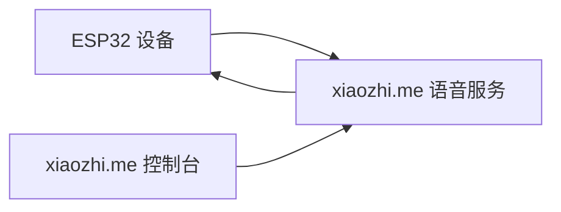
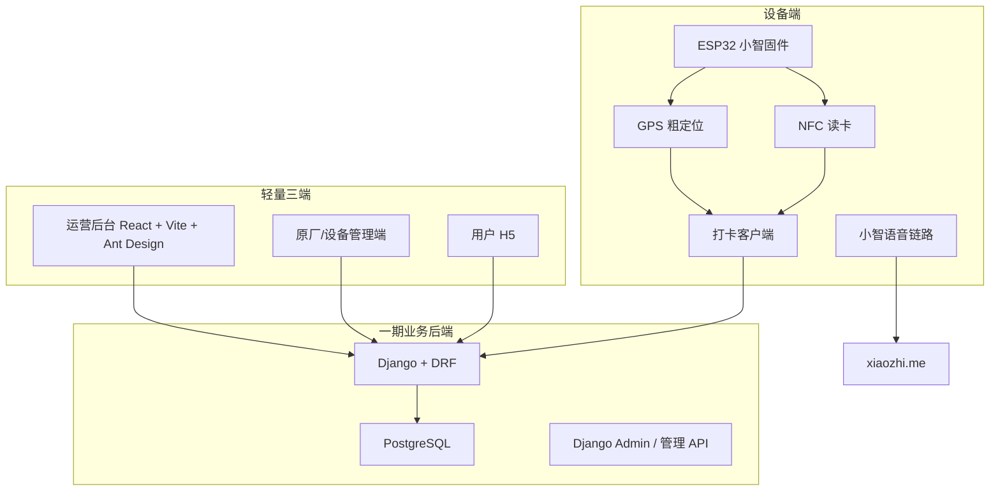
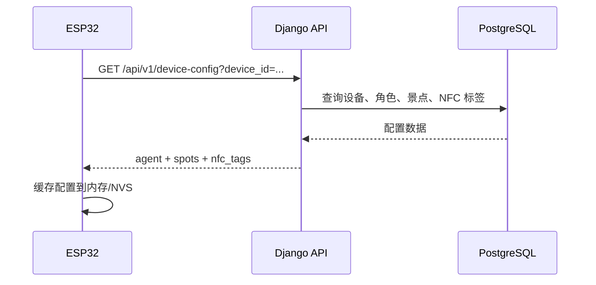
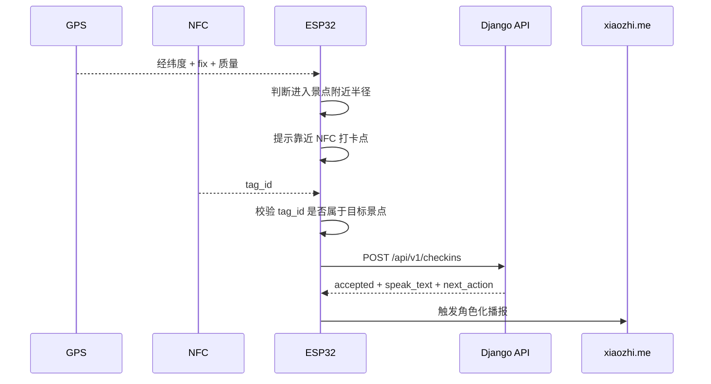
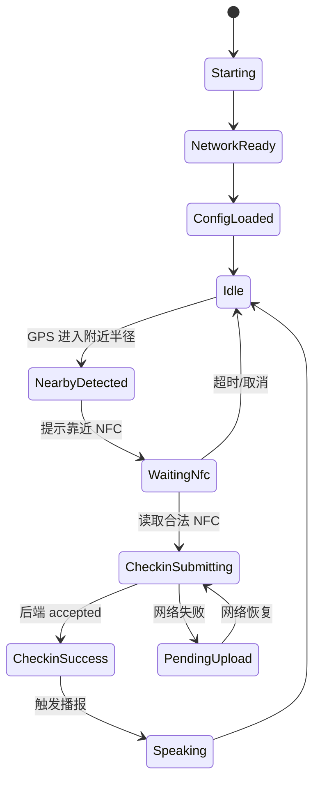

# 工程架构总览

文档状态：`confirmed`

主责智能体：架构师智能体

更新时间：2026-07-12

## 0. 关联资料

| 文档 | 关系 |
| --- | --- |
| [README.md](README.md) | 项目资料入口 |
| [document_index.md](document_index.md) | 项目文档总索引 |
| [project_role_agents.md](project_role_agents.md) | 项目角色边界 |
| [agent_document_requirements.md](agent_document_requirements.md) | 智能体文档责任和核对规则 |
| [xiaozhi_existing_capabilities_analysis.md](xiaozhi_existing_capabilities_analysis.md) | 小智 ESP32 底座能力分析 |
| [research_topic_related.md](research_topic_related.md) | 课题方向需求说明 |
| [phase1_phase2_architecture_plan.md](phase1_phase2_architecture_plan.md) | 一期/二期架构建议 |
| [fullstack_implementation_guide.md](fullstack_implementation_guide.md) | 全栈实施说明 |

## 1. 本文目的

本文用于从架构师视角说明当前项目的工程边界、模块划分、数据流、状态流、技术栈和主要风险。本文不替代产品需求文档、研发排期文档、测试计划或发布手册。

当前确认口径：

- 一期只处理架构师责任范围内文档。
- 一期建设后端和轻量三端适配，但不是完整商业化 App 或完整商业化后台。
- 一期技术主线为：`ESP32 小智固件 + xiaozhi.me 语音链路 + Django/DRF + PostgreSQL + React/Vite/Ant Design + GPS 粗定位 + NFC 精准确认`。
- 一期 NFC 使用标签 UID 或静态 `tag_id` 校验；签名 payload、动态 token、防复制机制放到二期评估。
- 一期 GPS 只用于附近提醒，不作为打卡成功的最终依据。
- 一期后端主要提供业务配置和打卡调用接口，语音链路继续依托 `xiaozhi.me`，类似官网控制台的角色/提示词配置思路。
- 一期数据集使用真实景区数据，但格式暂不固定；前端先用通用结构承载，后续统一整改数据集模块。
- 一期 MCP / 工具入口允许仍配置在小智官网侧，但工具调用应指向我方后端；自研系统保存业务配置、角色提示词源、景区知识库和打卡数据。

## 2. 当前工程现状

### 2.1 固件仓库现状

当前代码仓库是小智 ESP32 固件项目，不是完整业务平台。它已经具备：

| 能力 | 当前状态 | 本项目复用方式 |
| --- | --- | --- |
| 语音输入/输出 | 已有 | 复用麦克风采集、TTS 播放、提示音 |
| 设备状态机 | 已有 | 接入附近提醒、打卡播报、错误提示 |
| 网络通信 | 已有 WebSocket / MQTT+UDP | 一期继续连接 `xiaozhi.me` 语音服务 |
| 设备身份 | 已有 UUID / MAC 等基础信息 | 作为业务后端设备识别依据 |
| MCP 工具 | 已有 | 后续可扩展设备状态、定位、打卡工具 |
| 外设接入范式 | 已有 UART/I2C/SPI 范式 | 新增 GPS、NFC 外设模块 |
| Web 后台 | 当前仓库无 | 一期新增 Django/React 业务平台 |

### 2.2 当前对官网的依托

一期不重做小智语音服务。设备语音对话、ASR、LLM、TTS 仍依托 `xiaozhi.me` 官方服务或官方链路。

本项目一期新增的后端不替代 `xiaozhi.me`，只负责：

- 设备业务配置。
- 角色绑定信息。
- 景点配置。
- NFC 标签配置。
- 打卡记录。
- 景区知识库查询接口。
- 角色提示词/上下文生成接口。
- 给设备返回打卡后需要播报的文本或上下文。

### 2.3 小智官网能力边界与自研替代节奏

当前仓库可复用的是小智 ESP32 固件和设备侧能力；`xiaozhi.me` 官网控制台、官网后台、云端语音编排和官网侧 MCP 管理能力不属于当前项目源码边界。一期课题 Demo 可以依托官网完成语音链路、设备接入和 MCP/工具调用入口，但这些官网页面不应作为对专家、领导或演示用户展示的主界面。

一期对外展示口径是：在调用小智官网能力的前提下，使用自研后台管理景点数据、角色配置源、点位、NFC、打卡记录和知识库接口；小智官网侧只配置工具/MCP 接入点，由官网调用我方后端获取角色上下文和景区知识。

架构口径：

| 阶段 | 官网关系 | 自研系统责任 |
| --- | --- | --- |
| 一期课题演示 | 官网作为不可见依赖，承载语音链路、设备接入和 MCP/工具调用入口 | 自建业务后台和轻量页面，保存设备、角色、点位、NFC、打卡记录、提示词配置源和景区知识库，并提供工具接口给官网侧调用 |
| 二期市场化 MVP | 逐步把高频运营能力从官网迁回自研系统 | 自研设备智能体控制台，优先覆盖设备、角色、提示词、音色引用、基础 MCP 映射、日志和权限 |
| 后续平台官网化 | 官网能力只作为参考或可选兼容通道 | 自研账号、多租户、计费、运营、监控、OTA、灰度和安全治理 |

产品侧如果提出“复刻小智官网”，建议按市场化硬性要求拆分，不做像素级复制，也不把非必要的平台功能提前塞进课题一期。市场化最小必要范围包括：

- 设备控制台：设备注册、SN、在线状态、版本、绑定角色、配置下发、远程操作。
- 角色智能体控制台：角色名称、人设 prompt、开场白、语言、音色引用、知识库、启停状态、版本记录。
- MCP / 工具能力管理：工具注册、接入点、工具权限、调用日志、设备侧工具映射。
- 业务数据闭环：用户、设备、角色、打卡、对话摘要、异常日志和运营配置进入自研数据库。
- 运维与安全：设备 token、接口签名、权限、审计日志、配置版本、回滚和异常告警。

## 3. 一期目标工程架构

### 3.1 架构边界

| 边界 | 归属 | 说明 |
| --- | --- | --- |
| 实时语音流 | 小智官网或后续自建小智语音服务 | Django 不承载实时音频流 |
| 设备业务配置 | Django 后端 | 设备、角色、景点、NFC 标签 |
| 打卡确认 | 设备端 + Django 后端 | NFC 读卡后上报，后端幂等记录 |
| 角色提示词/上下文 | Django 后台保存并生成，官网侧只配置接入点或工具入口 | 一期优先让小智官网通过工具/MCP 调用我方接口；若官网不支持自动化配置，才保留最少人工配置入口 |
| GPS | 设备端 | 只用于附近提醒和定位质量摘要 |
| NFC | 设备端 | 作为打卡成功的物理点位依据 |
| 用户端展示 | React H5 | 一期只展示角色、景点、打卡状态 |

## 4. 模块划分

### 4.1 设备端模块

建议新增固件模块：

| 模块 | 职责 |
| --- | --- |
| `location` | GPS 串口读取、NMEA 解析、定位缓存、距离计算 |
| `nfc` | NFC 标签读取、UID/payload 获取、标签校验 |
| `checkin` | 附近判断、NFC 确认、防重复、事件生成、失败兜底 |
| `agent` | 当前角色上下文、播报文案、语音链路触发上下文 |

边界要求：

- 板卡目录只放引脚、总线、供电等硬件差异。
- `Application` 只接入事件，不写景点匹配和 NFC 校验算法。
- NFC 错误标签不能触发打卡。
- 无 GPS fix 时允许 NFC 直接确认打卡，但不触发“附近提醒”。

### 4.2 后端模块

建议 Django apps：

| App | 职责 |
| --- | --- |
| `devices` | 设备身份、绑定角色、设备状态、最近活跃时间 |
| `agents` | 角色名、voice_id、personality_prompt、知识库引用、上下文生成策略 |
| `spots` | 景点名称、坐标、GPS 提醒半径、播报文案 |
| `nfc_tags` | 标签 ID、所属景点、启用状态、安全版本 |
| `checkins` | 打卡事件、幂等、防重复、记录查询 |

### 4.3 前端模块

一期轻量三端：

| 端 | 范围 |
| --- | --- |
| 运营后台 | 设备、角色、景点、NFC 标签、打卡记录管理 |
| 原厂/设备管理端 | 设备登记、绑定角色、查看设备配置 |
| 用户 H5 | 当前角色、景点信息、打卡状态、打卡成功页 |

## 5. 核心数据流

### 5.1 设备启动与配置拉取

### 5.2 GPS 附近提醒与 NFC 打卡

### 5.3 打卡后问答上下文

一期不改造完整语音服务，只把当前角色和景点上下文作为配置/提示词来源：

- Django 保存 `agent.personality_prompt`。
- Django 保存 `spot.checkin_message`。
- Django 提供 `agent-context` 或等价接口，生成角色 + 景点 + 打卡状态上下文。
- Django 提供 `knowledge/search` 或等价接口，供小智官网侧工具/MCP 查询景区知识。
- 设备打卡成功后可触发固定播报文本。
- 景点问答一期仍依托官网语音链路，但知识和上下文由我方后端提供；官网侧只做一次性工具/接入点配置，不把景区知识手工塞进官网后台。

## 6. 状态模型

### 6.1 设备侧状态

### 6.2 后端打卡状态

| 状态 | 含义 |
| --- | --- |
| `accepted` | 首次有效打卡 |
| `duplicate` | 冷却时间内重复上报 |
| `invalid_tag` | NFC 标签不存在或未启用 |
| `device_unknown` | 设备未登记 |
| `spot_mismatch` | 标签与景点不匹配 |

## 7. 技术栈

### 7.1 一期推荐技术栈

| 层级 | 技术 |
| --- | --- |
| 固件 | ESP-IDF + C++ |
| 语音 | `xiaozhi.me` 官方链路 |
| 后端 | Django + Django REST Framework |
| 数据库 | PostgreSQL |
| 前端 | React + Vite + Ant Design，响应式页面 |
| 部署 | Nginx + Gunicorn + PostgreSQL，单台云服务器 |

### 7.1.1 当前工程脚手架状态

| 目录 | 状态 | 说明 |
| --- | --- | --- |
| `main/` | 已有 | 保留小智 ESP32 固件，不放 Django/React 代码 |
| `backend/` | 已创建 | Django/DRF 脚手架、apps 分层、依赖、环境示例已建立 |
| `frontend/` | 已创建 | React/Vite/TypeScript/Ant Design 脚手架、P0 页面入口已建立 |
| `tools/device_simulator/` | 已创建 | 无硬件阶段模拟设备拉配置、心跳、GPS 接近、NFC 打卡 |
| `deploy/` | 已创建 | 简易本地/服务器部署说明、环境变量示例、Nginx/Gunicorn 可选参考；Docker Compose 后置 |
| `PROJECT_STRUCTURE.md` | 已创建 | 面向研发主管和全栈工程师的单仓多模块说明 |

已执行的框架验证：

- `backend`: `.venv\Scripts\python manage.py check` 通过。
- `frontend`: `npm run build` 通过。

注意：前端 `npm install` 后报告 1 个 moderate 和 1 个 high 级别依赖审计问题，当前未执行 `npm audit fix --force`，避免引入破坏性升级；后续由全栈工程师在实现阶段评估处理。

### 7.2 二期演进

| 能力 | 二期方向 |
| --- | --- |
| 语音私有化 | 评估 `xiaozhi-esp32-server` 作为参考基座 |
| 自研控制台替代层 | 设备、角色、提示词、MCP 工具、日志、权限从官网迁回自研系统 |
| 位置能力 | PostgreSQL + PostGIS 可选 |
| 异步任务 | Redis + Celery |
| 设备事件增长 | 需要时引入事件网关或队列 |
| NFC 防作弊 | 签名 payload、动态 token、点位巡检 |

## 8. 容量假设

| 指标 | 一期 | 二期 |
| --- | --- | --- |
| 设备数量 | 3 台 | 1000 台 |
| 峰值在线设备 | 3 台以内 | 100 台 |
| 峰值语音并发 | 1-3 路演示 | 10 路 |
| 用户访问 | 10 人级 | 后续压测 |
| 部署资源 | 1 台云服务器 | 可拆分服务 |

判断：

- 该容量下 Django 足以承载业务 API。
- 语音流不能进入 Django。
- 一期 GPS 摘要按 10 秒级节流上报；如果二期 GPS 变成更高频持续上报，需要队列或独立事件接入层。

## 9. 风险与待决策项

### 9.1 已确认风险控制

| 风险 | 当前控制 |
| --- | --- |
| GPS 1m 精度不可控 | GPS 只做附近提醒，NFC 做最终确认 |
| 官网依赖 | 一期接受，二期评估私有化 |
| 官网控制台能力闭源/不可控 | 一期仅作为 Demo 依赖，市场化二期建设自研设备智能体控制台 |
| NFC 标签复制 | 一期静态校验，二期升级签名 payload |
| 后端范围膨胀 | 一期只做轻量三端和业务 API |
| 实时语音压力 | 不进入 Django |

### 9.2 需用户后续决策

| 问题 | 选项 | 架构影响 |
| --- | --- | --- |
| 一期后端工时 | 轻量 Django Admin 起步 / React 三端一起做 | 影响一期交付范围和人力 |
| GPS 数据保存 | 已确认一期只保存定位质量摘要，按 10 秒级节流 | 影响接口节流和安全文档 |
| NFC 安全等级 | 静态 tag_id / 签名 payload / 动态 token | 影响标签写入、固件验证和后端校验 |
| 语音私有化时机 | 二期后 / 二期内 / 不做 | 影响是否引入 `xiaozhi-esp32-server` |
| 官网功能复刻深度 | 市场化必要复刻 / 接近官网核心功能 / 完整平台官网级复刻 | 影响二期排期、团队配置和服务拆分 |

### 9.3 GPS 数据保存难度拆分

| 方案 | 技术难度 | 说明 |
| --- | --- | --- |
| 只保存打卡事件和定位质量摘要 | 低 | 一期采用，隐私风险最低；定位摘要按 10 秒级节流上报 |
| 保存设备最近一次位置 | 中 | 可支持管理端看最近状态，需要权限和过期策略 |
| 保存连续 GPS 轨迹 | 高 | 需要更明确授权、数据生命周期、存储增长评估和安全策略 |

架构建议：

- 一期只保存打卡事件和定位质量摘要，定位摘要按 10 秒级节流上报。
- 如果你希望保留定位能力，可增加“最近一次位置”，并设置过期时间。
- 连续轨迹不建议一期做，除非产品和课题验收明确需要。

## 10. 一期后端工时粗估

以下是架构粗估，不替代研发主管排期：

| 范围 | 粗估 |
| --- | --- |
| Django 数据模型 + Django Admin | 2-3 人日 |
| DRF 基础 API：配置拉取、打卡上报、CRUD | 3-5 人日 |
| React 运营后台轻量页 | 4-7 人日 |
| 用户 H5 简单展示 | 2-3 人日 |
| 设备联调、幂等、错误处理 | 3-5 人日 |
| 单机部署、Nginx、备份脚本 | 1-2 人日 |

判断：

- 如果只做 Django Admin + API + 简单 H5，约 1-2 周可形成可演示版本。
- 如果 React 三端都要体验完整，约 2-3 周更稳。
- 以上不包含 ESP32 固件 GPS/NFC 驱动开发时间。

### 10.1 小智官网能力自研替代增量粗估

以下估算站在架构师视角，用于产品经理判断市场化投入，不替代研发主管排期。这里的“自研替代”指替代产品必需的官网控制台能力，不指复制官网 UI。

| 自研替代范围 | 在一期基础上的增量 | 主要内容 |
| --- | --- | --- |
| 一期课题演示封装 | 不新增或少量新增 | 官网作为不可见依赖；自研页面展示景点数据、打卡结果和角色配置源 |
| 市场化必要控制台 MVP | 4-6 周 | 设备管理、角色配置、提示词、音色引用、绑定、基础 MCP 映射、调用日志 |
| 接近官网核心控制台能力 | 8-12 周 | 模型配置、TTS/ASR 配置、多协议设备接入、MCP 工具注册/调用、设备远控、对话日志、权限、OTA/配置版本 |
| 完整平台官网级能力 | 3-6 个月 | 账号体系、控制台、多租户、计费/套餐、设备云、语音服务编排、运维监控、灰度、安全治理 |

架构建议：

- 一期不复刻官网，官网页面不作为对外演示入口；对外展示自研轻量交互页面和景区业务闭环。
- 一期自研后台的数据模型仍按“未来替代官网控制台”设计，避免二期推倒重来。
- 二期是否以“自研设备智能体控制台”为正式项目立项，需要产品经理结合市场化交付对象、私有化要求和客户数据边界确认。
- 语音实时链路是否私有化可和控制台复刻解耦；业务配置、设备绑定和数据闭环应优先迁回自研系统。

### 10.2 需产品经理 Agent 核对的问题点

| 编号 | 问题 | 架构影响 |
| --- | --- | --- |
| PM-Q1 | 一期演示时，是否允许内部使用 `xiaozhi.me` 官网控制台，但不向专家/领导展示该页面？ | 决定一期是否只做自研轻量页面，不做官网功能复刻 |
| PM-Q2 | 一期是否只需要证明“景点数据 + 多一层角色提示词 + GPS/NFC 打卡 + 语音播报”的闭环？ | 决定一期后端只做业务数据源和调用接口 |
| PM-Q3 | 一期角色 prompt 是否由自研后台保存并生成上下文，官网侧只配置接入点？ | 已确认：是，优先让官网调用我方后端；必要时保留最少人工配置 |
| PM-Q4 | 一期 MCP/工具入口是否允许仍配置在小智官网侧，但调用我方业务和知识库接口？ | 已确认：一期允许 |
| PM-Q5 | 市场化 MVP 的客户是否要求私有化部署或不能依赖第三方官网账号？ | 决定二期自研控制台优先级 |
| PM-Q6 | 市场化首版是否需要完整语音私有化，还是只要求业务后台和控制台自研？ | 决定 `xiaozhi-esp32-server` 是否进入二期主路径 |

## 11. 当前确认状态

| 项 | 状态 |
| --- | --- |
| 一期架构主线 | 已确认 |
| Django/DRF/PostgreSQL/React/Vite/Ant Design | 已确认 |
| xiaozhi.me 一期语音依托 | 已确认 |
| GPS 只做附近提醒 | 已确认 |
| NFC 静态校验一期采用 | 已确认 |
| API 版本 `/api/v1` | 已确认 |
| 一期官网作为不可见依赖，不复刻官网页面 | 已确认 |
| 一期数据集 | 已确认：使用真实景区数据，格式后续统一整改 |
| 设备配置兜底 | 已确认：以后端拉取为主，允许固件静态配置兜底 |
| 管理端认证 | 已确认：一期使用演示账号 |
| 角色 prompt/上下文 | 已确认：自研后台保存和生成，官网侧只配置接入点 |
| 一期 MCP/工具配置 | 已确认：允许入口在小智官网侧，但调用我方后端接口 |
| 市场化官网能力自研替代节奏 | 待产品经理 Agent 核对 |
| GPS 数据保存策略 | 已确认：保存定位质量摘要，10 秒级节流，不保存连续轨迹 |
| 一期后端工时范围 | 待用户确认 |
