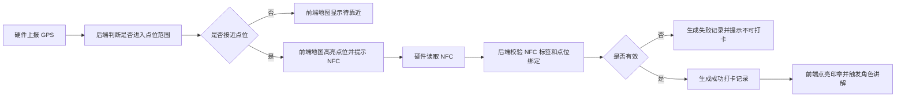

# 一期前端交互原型设计说明

> 责任角色：产品经理智能体  
> 文档状态：confirmed  
> 原型文件：[xiaozhi_style_workspace_demo.html](xiaozhi_style_workspace_demo.html)  
> 适用范围：前端整改任务输入，不定义接口、工程结构和技术实现

## 1. 核心结论

一期前端需要拆成两个明确视角：

| 视角 | 面向对象 | 页面定位 | 是否可配置智能体 |
| --- | --- | --- | --- |
| 用户端 | 盲盒硬件持有者、现场游客 | 专属智能体对话 + 景区游戏化打卡 | 否 |
| 管理员端 | 原厂管理员、项目管理员、演示管理员 | 智能体配置、设备绑定、官网同步 | 是 |

盲盒产品规则必须体现在前端：用户不能自己选择或切换智能体。每台实体机器人出厂绑定一个智能体，后期只能由原厂后台更换。

## 2. 用户端设计说明

用户端默认进入“我的伙伴/对话”体验，不进入后台工作台。

| 页面 | 设计口径 | 一期要求 |
| --- | --- | --- |
| 我的伙伴 | 展示当前硬件绑定的唯一智能体 | 只允许与绑定角色对话 |
| 景区打卡 | 做成轻量小游戏地图，而不是后台记录页 | 地图点位、定位光圈、点位弹窗、印章进度 |
| 我的图鉴 | 展示已点亮印章、待解锁点位和角色回忆 | 以收集感表达打卡进度 |

用户端禁止出现：

| 禁止项 | 原因 |
| --- | --- |
| 角色 Prompt 配置 | 用户不能改人格 |
| 音色/模型/知识库配置 | 属于后台能力 |
| 官网同步状态 | 用户不需要理解小智官网对接 |
| 设备绑定/解绑入口 | 违背盲盒单实体单智能体规则 |
| 景点/NFC/数据集管理菜单 | 属于管理员后台，不是用户体验 |

## 3. 景区打卡页设计说明

景区打卡页应更像“活动小游戏”，而不是管理端表格。

| 元素 | 说明 |
| --- | --- |
| 景区地图 | 用可爱、轻量、游戏化的地图视觉表达三坊七巷 |
| 打卡点位 | 地图上展示多个点位节点，Demo 至少一个点位完整跑通 |
| 硬件当前位置 | 用定位光圈或扫描效果表达 GPS 连接和接近状态 |
| GPS 状态 | 负责“靠近提醒”，不作为最终成功依据 |
| NFC 状态 | 负责“精准确认”，完成后点亮印章 |
| 点位弹窗/卡片 | 点击点位后展示故事、状态、角色提示和打卡动作 |
| 印章图鉴 | 展示已点亮、待打卡、隐藏奖励 |

视觉参考方向：可以借鉴开放世界/活动地图的沉浸感、路径感和收集感，但不复制任何具体游戏 IP、素材、角色或美术资产。

## 4. 管理员端设计说明

管理员端用于自研平台配置和演示管理，风格可参考小智官网控制台的清爽卡片式布局。

| 页面 | 设计口径 | 一期要求 |
| --- | --- | --- |
| 智能体管理 | 卡片式展示智能体 | 显示角色、模型/音色、绑定设备、最近对话、官网同步状态 |
| 配置弹窗 | 点击“配置”打开弹窗 | 不使用右侧区域局部变化作为配置入口 |
| 设备绑定 | 管理单设备单智能体关系 | 显示当前绑定关系和不可由用户切换的规则 |
| 官网同步 | 展示同步快照和状态 | 一期接受人工/半自动同步，不强制自动调用官网 API |

管理员端需要服务两个目标：

1. 课题一期：证明景区数据定制化智能体、GPS/NFC 打卡、对话记录、同步留痕可演示。
2. 市场化后续：保留盲盒多性格、单实体单智能体、原厂后台更换绑定的商业化路径。

## 5. 前端任务口径

前端整改时，应按以下优先级理解：

| 优先级 | 任务 | 说明 |
| --- | --- | --- |
| P0 | 用户端单角色对话页 | 默认只展示绑定智能体，不能切换和配置 |
| P0 | 用户端游戏化景区打卡页 | 地图模式、点位、GPS/NFC 状态、印章进度 |
| P0 | 管理员端智能体卡片页 | 对标小智官网风格，但展示我方业务状态 |
| P0 | 管理员端配置弹窗 | Prompt、音色、知识库引用、同步状态 |
| P0 | 管理员端设备绑定/官网同步 | 体现单设备单智能体和半自动同步留痕 |
| P1 | 地图美术深化和动效 | 前端可在现有交互口径上自行发挥 |

## 6. 前后端交接说明

### 6.1 前端实现说明

前端可以直接参考原型文件的交互结构，但不需要照搬当前粗糙美术。最终实现应套用项目现有前端框架、组件体系和路由方式。

| 模块 | 前端任务 | 说明 |
| --- | --- | --- |
| 用户端我的伙伴 | 单角色对话页 | 默认展示当前硬件绑定智能体，不提供切换按钮 |
| 用户端景区打卡 | 游戏化地图页 | 可模仿游戏活动地图的层次、路线、节点、奖励反馈，但不能复制具体游戏 IP 或素材 |
| 用户端我的图鉴 | 印章/回忆收集页 | 展示已点亮、待点亮、隐藏奖励等状态 |
| 管理员端智能体管理 | 卡片式工作台 | 参考小智官网清爽卡片风格，展示我方业务状态 |
| 管理员端配置 | 弹窗配置 | 点击“配置”弹出表单，不使用右侧详情区域切换 |
| 管理员端设备绑定 | 单设备单智能体展示 | 明确设备当前绑定角色和不可由用户切换的规则 |
| 管理员端官网同步 | 同步状态/快照页 | 展示待同步、已同步、失败、操作人、时间、备注 |

前端可自由深化的部分：

| 可发挥项 | 建议 |
| --- | --- |
| 地图美术 | 做成更可爱、更沉浸的景区活动地图 |
| 点位动效 | 可加入呼吸、扫描、靠近高亮、点亮印章动画 |
| 角色陪伴 | 可在地图或对话页加入角色头像、气泡提示、语音播报状态 |
| 打卡反馈 | NFC 成功后可做“印章盖下去”“奖励弹出”等反馈 |
| 响应式适配 | 手机端优先保证对话和打卡地图可用，后台配置以 PC 为主 |

### 6.2 后端实现说明

后端不负责地图美术，但需要提供用户端和管理员端都能消费的业务状态。

| 能力 | 后端需要提供的数据 | 说明 |
| --- | --- | --- |
| 当前用户绑定智能体 | 当前 device_id 对应的唯一 agent_id、角色名称、头像/标识、状态 | 用户端只能展示这个角色为可用 |
| 角色不可切换规则 | 其他角色的锁定/未拥有状态 | 可用于用户端展示未拥有角色，但不允许选择 |
| 对话记录 | user_input、ai_reply、agent_id、device_id、spot_id、knowledge_summary、time、source | 用户端展示最近对话，管理员端用于追溯 |
| 景区点位 | spot_id、名称、坐标/地图位置、GPS 半径、展示文案、印章状态 | 前端用来画地图节点 |
| GPS 状态 | 是否有定位、是否进入点位范围、最近定位时间 | 只表示接近提醒 |
| NFC 状态 | tag_id、是否有效、是否绑定点位、打卡结果 | 作为精准打卡成功依据 |
| 打卡记录 | device_id、agent_id、spot_id、tag_id、result、time、failure_reason、source | 用户端点亮图鉴，管理员端追溯问题 |
| 官网同步状态 | agent_id、snapshot、status、operator、synced_at、failure_reason | 仅管理员端展示 |

### 6.3 打卡页前后端联动流程

### 6.4 研发主管下发任务时的表述建议

可以直接按以下口径下发给前后端：

| 对象 | 任务口径 |
| --- | --- |
| 前端 | 基于现有框架重做一期前端原型，拆分用户端和管理员端。用户端默认对话，只允许当前绑定智能体；景区打卡做成游戏化地图。管理员端做智能体管理、设备绑定、官网同步，配置使用弹窗 |
| 后端 | 补齐用户当前绑定智能体、点位状态、GPS 接近状态、NFC 打卡结果、打卡记录、对话记录、官网同步状态等接口或数据结构 |
| 联调 | 先跑通 1 台设备、1 个绑定角色、1 个景区点位、GPS 接近、NFC 成功、印章点亮、角色讲解、记录留痕 |

## 7. 验收口径

| 编号 | 验收标准 |
| --- | --- |
| A-01 | 用户端默认不出现管理员后台菜单 |
| A-02 | 用户端只能与当前硬件绑定智能体对话 |
| A-03 | 用户端其他角色只能作为未拥有/不可选展示，不可切换 |
| A-04 | 景区打卡页呈现地图、点位、定位状态、印章进度 |
| A-05 | 景区打卡页能表达 GPS 粗定位 + NFC 精准确认 |
| A-06 | 管理员端能进入智能体管理、设备绑定、官网同步 |
| A-07 | 管理员端点击配置以弹窗形式出现 |
| A-08 | 原型能支撑研发主管向前端下发视觉和交互整改任务 |
