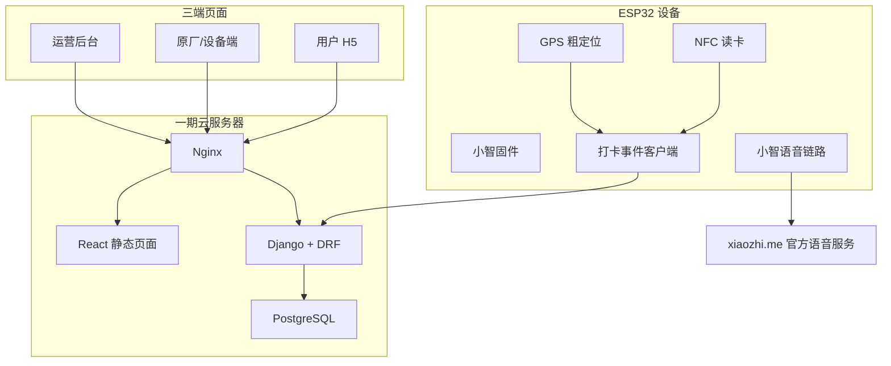
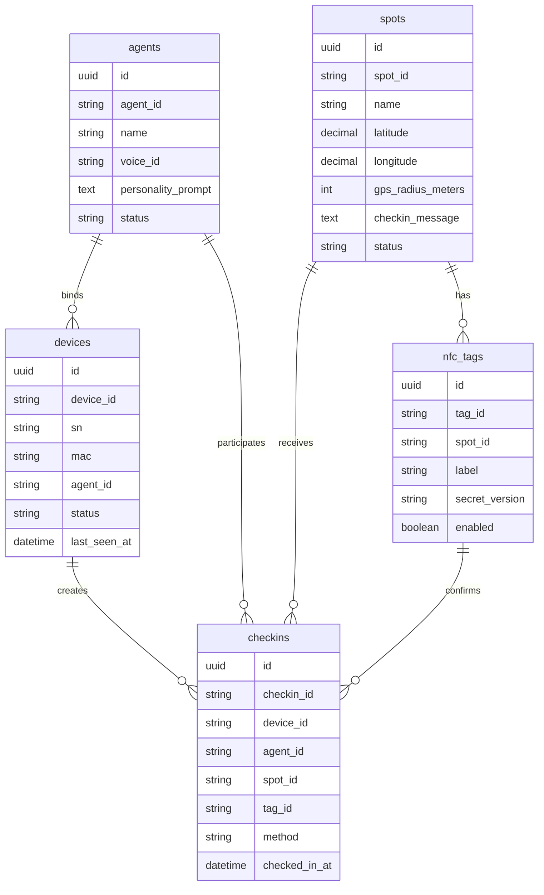
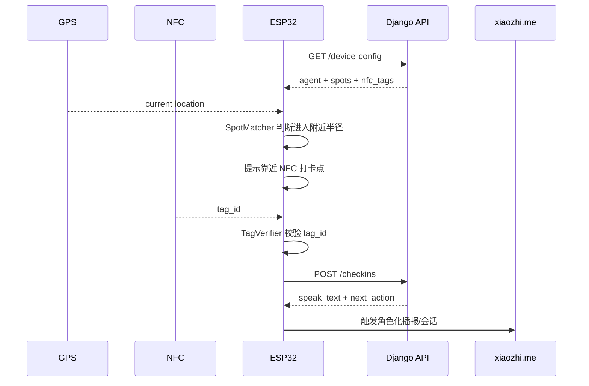
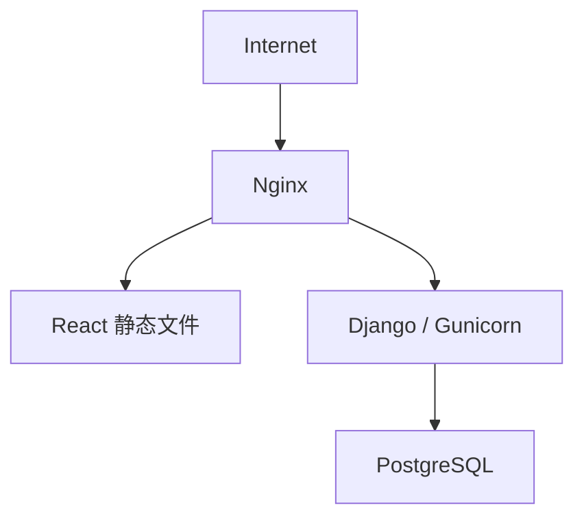

# 全栈实施说明：盲盒角色智能体旅游打卡一期框架

## 0. 文档状态与关联资料

本文偏课题 Demo 的全栈实施说明，包含 GPS/NFC/打卡/三端页面等工程落地内容。市场化方向可复用其中“设备、角色、绑定、管理端”部分，但不以景区/GPS 作为一期主线。

| 文档 | 关系 |
| --- | --- |
| [document_index.md](document_index.md) | 项目文档总索引 |
| [project_role_agents.md](project_role_agents.md) | 项目角色边界 |
| [agent_document_requirements.md](agent_document_requirements.md) | 智能体文档责任和核对规则 |
| [xiaozhi_existing_capabilities_analysis.md](xiaozhi_existing_capabilities_analysis.md) | 小智 ESP32 底座能力分析 |
| [research_topic_related.md](research_topic_related.md) | 课题方向需求说明 |
| [marketization_related.md](marketization_related.md) | 市场化方向需求说明 |
| [phase1_phase2_architecture_plan.md](phase1_phase2_architecture_plan.md) | 一期/二期架构建议 |
| [phase1_single_robot_implementation_plan.md](phase1_single_robot_implementation_plan.md) | 单台演示机器人研发落地计划 |

## 1. 目标

本文面向全栈开发人员，说明一期项目如何落地。

一期目标不是完整商业化平台，而是在当前小智 ESP32 固件基础上，建设一个可演示的三端适配系统：

- 设备端：ESP32 小智固件 + GPS 粗定位 + NFC 精准打卡。
- 后端：Django + Django REST Framework。
- 数据库：PostgreSQL。
- 前端：React + Ant Design Pro 管理端，React H5 用户端。
- 语音链路：一期继续依托 `xiaozhi.me` 官网服务。

核心闭环：

> 设备接近景点后提示用户靠近 NFC 打卡点；设备读取合法 NFC 标签后上报打卡；后端记录设备、角色、景点、标签和时间；设备触发角色化语音播报。

## 2. 一期整体架构



## 3. 推荐仓库结构

当前仓库是固件仓库。一期已确认采用单仓多模块方案：保留 `main/` 作为小智 ESP32 固件目录，新增 `backend/`、`frontend/`、`tools/device_simulator/` 和 `deploy/`。课题 Demo 阶段先放在当前仓库，便于统一交付。

```text
xiaozhi-esp32-main/
  main/
    # 原小智 ESP32 固件，后续只接入设备侧 API 调用
  backend/
    manage.py
    requirements.txt
    config/
    apps/
      devices/
      agents/
      spots/
      nfc_tags/
      checkins/
      datasets/
      demo/
  frontend/
    package.json
    src/
      app/
      pages/
      shared/
  tools/
    device_simulator/
  deploy/
  docs/
    blindbox_project/
  PROJECT_STRUCTURE.md
```

当前脚手架状态：

| 模块 | 状态 | 说明 |
| --- | --- | --- |
| `backend/` | 已创建 | Django 配置、DRF、apps 分层、`.env.example`、`requirements.txt` 已就位 |
| `frontend/` | 已创建 | React/Vite/TypeScript/Ant Design、P0 页面入口、`package.json` 已就位 |
| `tools/device_simulator/` | 已创建 | 可模拟设备配置拉取、心跳、GPS 接近和 NFC 打卡 |
| `deploy/` | 已创建 | 提供简易本地/服务器部署说明、环境变量示例、Nginx/Gunicorn 可选参考；Docker Compose 后置 |

框架验证：

- 后端：`.venv\Scripts\python manage.py check` 已通过。
- 前端：`npm run build` 已通过。

## 4. 后端模块设计

### 4.1 Django Apps

| App | 职责 |
| --- | --- |
| `devices` | 设备身份、SN、MAC、绑定角色、在线状态 |
| `agents` | 角色名称、Prompt、voice_id、知识库引用 |
| `spots` | 景点名称、经纬度、GPS 提醒半径、启用状态 |
| `nfc_tags` | NFC 标签、所属景点、启用状态、安全版本 |
| `checkins` | 打卡事件、幂等、防重复、记录查询 |
| `datasets` | 真实景区数据集状态、摘要片段、知识查询 |
| `demo` | 演示总览、无硬件模拟打卡 |

### 4.2 核心数据模型



### 4.3 API 设计

设备拉取配置：

```http
GET /api/v1/device-config?device_id={device_id}
```

响应：

```json
{
  "device_id": "device_001",
  "agent": {
    "agent_id": "agent_alo",
    "name": "阿洛",
    "voice_id": "voice_alo_01",
    "personality_prompt": "你是一个活泼、好奇、喜欢讲故事的旅游伙伴。"
  },
  "spots": [
    {
      "spot_id": "spot_gate_001",
      "name": "景区入口",
      "latitude": 31.2304,
      "longitude": 121.4737,
      "gps_radius_meters": 50
    }
  ],
  "nfc_tags": [
    {
      "tag_id": "04AABBCCDD",
      "spot_id": "spot_gate_001"
    }
  ]
}
```

设备上报打卡：

```http
POST /api/v1/checkins
```

请求：

```json
{
  "device_id": "device_001",
  "spot_id": "spot_gate_001",
  "tag_id": "04AABBCCDD",
  "method": "gps_nearby_nfc_confirmed",
  "event_time": "2026-07-10T10:00:00+08:00",
  "location_quality": {
    "fix": true,
    "satellites": 8,
    "hdop": 1.2
  }
}
```

响应：

```json
{
  "accepted": true,
  "checkin_id": "checkin_001",
  "agent_id": "agent_alo",
  "spot_id": "spot_gate_001",
  "speak_text": "你到啦！这里就是我们今天旅程的第一站。",
  "next_action": "start_spot_qa"
}
```

幂等规则：

- 同一 `device_id + spot_id + tag_id` 在冷却时间内只接受一次。
- 重复上报返回 `accepted: false`，但不视为服务错误。
- 后端记录原始请求摘要，方便调试。

### 4.4 后端风险点

- 不能信任设备直接传来的 `agent_id`，应以后端设备绑定关系为准。
- 一期可以用标签 UID 校验，二期要升级为签名 payload 或动态 token。
- 打卡接口必须限流，避免设备异常循环上报。
- GPS 原始轨迹不建议保存；一期只保存打卡时的质量摘要。

## 5. 前端三端说明

### 5.1 运营后台

技术建议：

```text
React + Ant Design Pro
```

一期页面：

- Dashboard：设备数、打卡数、景点数、角色数。
- 设备管理：列表、详情、绑定角色。
- 角色管理：角色名、voice_id、Prompt。
- 景点管理：景点坐标、GPS 半径、播报文案。
- NFC 标签管理：标签 ID、所属景点、启用/停用。
- 打卡记录：设备、角色、景点、标签、时间、方法。

### 5.2 原厂/设备端

一期可以复用运营后台工程，通过权限或菜单区分。

页面：

- 设备激活/登记。
- 设备绑定角色。
- 设备配置查看。
- 标签配置查看。

### 5.3 用户 H5

一期只做轻量展示。

页面：

- 当前角色信息。
- 景点列表。
- 已打卡记录。
- 打卡成功页。

用户 H5 不负责真实打卡确认，真实确认来自设备读取 NFC。

## 6. 设备端改造说明

### 6.1 新增模块

```text
main/location/
  gps_service.*
  nmea_parser.*
  geo_distance.*

main/nfc/
  nfc_reader.*
  tag_verifier.*

main/checkin/
  checkin_service.*
  spot_matcher.*

main/agent/
  agent_context.*
```

### 6.2 设备端流程



### 6.3 设备端兜底

- 后端不可用时，设备可使用上次缓存配置。
- NFC 成功但网络失败时，可本地缓存待上报事件。
- 冷却状态写入 NVS，重启后仍能防重复。

## 7. 部署建议

一期一台云服务器即可：



建议配置：

- 2 vCPU / 4GB RAM 起步。
- PostgreSQL 和 Django 同机部署。
- 每日数据库备份。
- Nginx HTTPS。
- 日志按天切割。

二期 1000 台设备、100 在线、10 路语音并发时：

- 业务 API 仍可由 Django 承载。
- GPS/NFC 打卡事件可先 HTTP 上报。
- 如果 GPS 变成秒级持续上传，再引入 Redis Stream/Kafka 或独立事件网关。
- 语音流不进入 Django，由官网或自建小智语音服务承载。

## 8. 开发顺序

建议按垂直切片交付：

1. 后端模型和 Django Admin。
2. 设备、角色、景点、NFC 标签 CRUD API。
3. React 运营后台基础页面。
4. 设备端 GPS/NFC 本地读取和串口调试。
5. 设备拉取配置。
6. 设备上报打卡。
7. 打卡成功触发角色播报。
8. 用户 H5 展示打卡结果。
9. 补离线缓存、幂等、限流和日志。

## 9. 验收清单

- 后台能创建角色、设备、景点、NFC 标签。
- 设备能拉取绑定角色和景点配置。
- GPS 能判断是否接近景点。
- NFC 能读取指定标签并匹配景点。
- 设备能上报打卡事件。
- 后台能查看打卡记录。
- 用户 H5 能查看角色和打卡状态。
- 到点后能触发小智语音播报。
- 网络失败时不丢失本地打卡事件。
