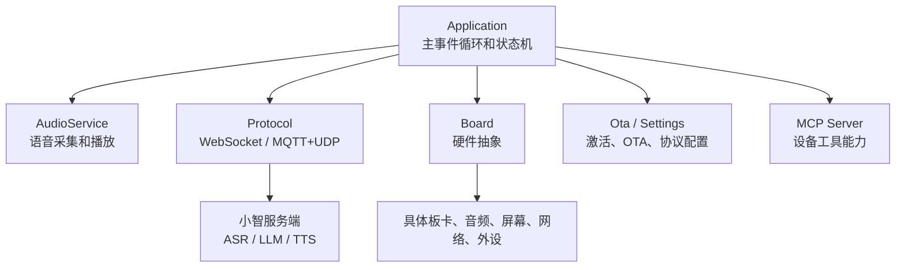
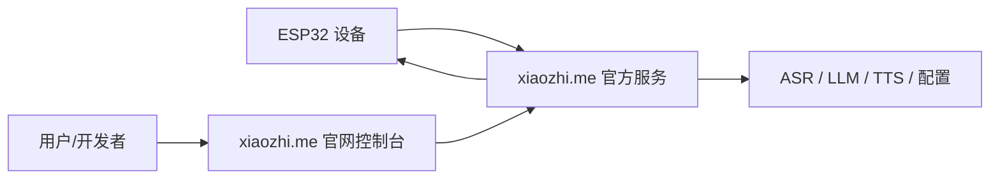
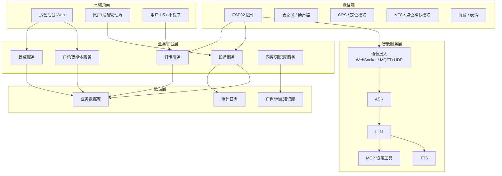
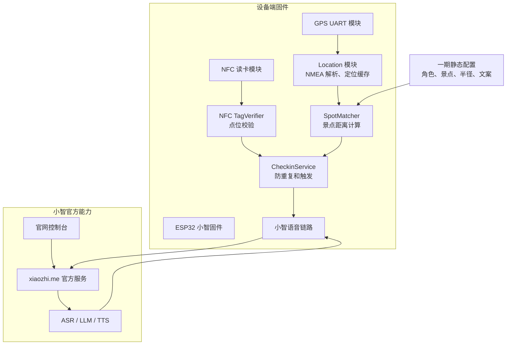
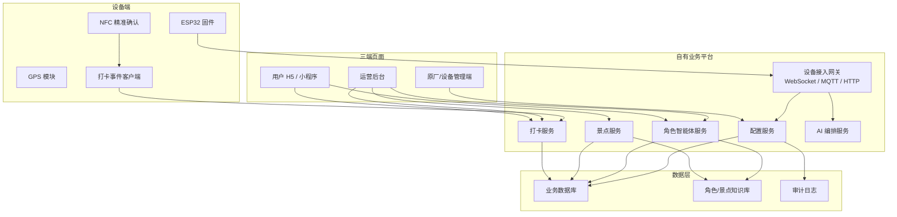
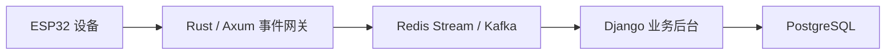
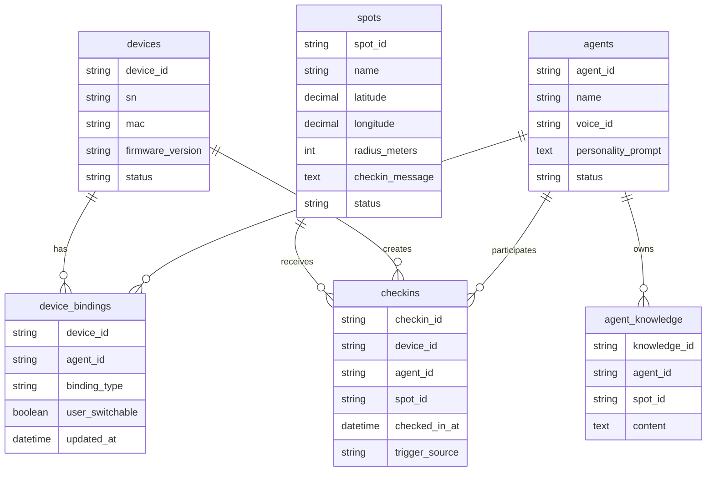

# 盲盒角色智能体旅游打卡项目一期建设文档与二期架构建议

## 0. 文档状态与关联资料

本文偏课题 Demo 和工程架构建议，包含 GPS + NFC 打卡等早期技术方案。市场化方向当前已拆分为“盲盒多性格 AI 智能体 + 单一实体机器人”，不以景区/GPS 作为一期主线。

| 文档 | 关系 |
| --- | --- |
| [document_index.md](document_index.md) | 项目文档总索引 |
| [xiaozhi_existing_capabilities_analysis.md](xiaozhi_existing_capabilities_analysis.md) | 小智 ESP32 底座能力分析 |
| [research_topic_related.md](research_topic_related.md) | 课题方向需求说明 |
| [marketization_related.md](marketization_related.md) | 市场化方向需求说明 |
| [fullstack_implementation_guide.md](fullstack_implementation_guide.md) | 全栈实施说明 |
| [phase1_single_robot_implementation_plan.md](phase1_single_robot_implementation_plan.md) | 单台演示机器人研发落地计划 |
| [phase1_single_robot_budget.md](phase1_single_robot_budget.md) | 单台演示机器人预算 |

## 1. 文档定位

本文基于当前 `xiaozhi-esp32-main` 固件仓库、产品经理需求文档和项目角色分工文档，给出一期建设范围、二期建设建议和未来整体架构资料。

当前项目本质是基于小智 ESP32 固件进行二次开发。现阶段优先验证“盲盒角色 IP + 语音智能体 + GPS 粗定位 + NFC 精准打卡”的最小闭环，而不是直接建设完整商业化平台。

参考资料：

- 本地固件仓库：`xiaozhi-esp32-main`
- 产品需求：[blindbox_agent_tourism_demo_prd.md](blindbox_agent_tourism_demo_prd.md)
- 课题版产品资料：`docs/盲盒交互陪伴机器人项目立项文件.docx`、`docs/盲盒交互陪伴机器人项目创新性说明.docx`、`docs/盲盒交互陪伴机器人项目竞品分析报告.docx`
- 项目角色分工：[project_role_agents.md](project_role_agents.md)
- 小智固件开源项目：https://github.com/78/xiaozhi-esp32
- 小智官方平台：https://xiaozhi.me/
- 可参考的自建服务端：https://github.com/xinnan-tech/xiaozhi-esp32-server

## 2. 当前项目现状

### 2.1 当前代码架构

当前仓库是 ESP-IDF/C++ 固件项目，不包含可直接运营的 Web 后台或用户端页面。核心模块如下：



关键边界：

- `Application` 负责初始化、网络事件、主循环、状态切换、协议回调。
- `Board` 负责屏蔽不同 ESP32 板卡、网络、音频、屏幕、外设差异。
- `Protocol` 负责 WebSocket 或 MQTT+UDP 通信。
- `Ota` 当前负责检查版本、激活、写入 MQTT/WebSocket 配置。
- `MCP Server` 负责设备能力发现和工具调用。

### 2.2 当前对官网的依托关系

当前如果不自建服务端，设备默认依托小智官方链路：



当前控制方式不是 Web 页面直连设备，而是：

1. 用户在 `xiaozhi.me` 控制台配置设备、模型、智能体或相关参数。
2. 设备开机联网后请求官方服务，获得激活和协议配置。
3. 设备通过 WebSocket 或 MQTT+UDP 与官方服务交互。
4. 官方服务完成 ASR、LLM、TTS，并把音频和控制消息返回设备。

因此，一期可以依托官网快速验证语音链路，但官网控制台不是我们的景区业务后台，不能完整承载景点、打卡、运营数据和用户侧玩法。

## 3. 产品目标和范围判断

### 3.1 课题版产品需求依据

课题版产品资料给出的核心方向是：

- 以“盲盒外观 + AI 语音交互 + 情感陪伴 + 个性化角色”为核心，做低成本智能陪伴机器人。
- 技术路线采用低成本 ESP32 等硬件，加云端 ASR、LLM、TTS 和角色 Prompt 管理。
- 第一阶段重点不是商业化大而全系统，而是完成可演示、可对话、可验证用户兴趣的 MVP。
- 中长期再扩展多角色、多外观、小批量试水、角色内容、软件会员和用户测试。
- 创新点集中在大模型智能体实体化、端云协同、角色人格配置、情感陪伴交互和盲盒机制。

因此，架构判断不能一开始就按完整 App、完整后台、会员系统和角色商城来做，而应先满足课题 Demo 的技术验证和展示价值，再为二期商业化平台预留边界。

### 3.2 P0 产品闭环

产品经理文档中定义的 P0 闭环包括：

- 设备唯一身份。
- 设备绑定单一角色。
- 角色人设提示词。
- 角色专属音色。
- 角色轻量知识库。
- 景点坐标配置。
- GPS 定位读取，用于判断是否接近景点。
- NFC 精准确认，用于确认用户到达指定打卡点。
- 到点判断和点位确认。
- 防重复触发。
- 到点角色播报。
- 景点后续问答。

本项目当前应采用两阶段推进：

- 一期：依托官网，完成可演示的设备端 GPS 粗定位、NFC 精准打卡和角色语音闭环。
- 二期：建设自有业务后台和三端页面，沉淀设备、角色、景点和打卡数据。

### 3.3 总体目标架构

面向未来，建议整体按“设备端 + 智能服务层 + 业务平台层 + 三端页面 + 数据层”拆分：



一期不会全部建设上图能力，只建设设备端 GPS 粗定位、NFC 精准打卡和官网语音链路；二期再补业务平台和三端页面。

### 3.4 容量与约束假设

当前阶段按以下容量假设设计：

| 项目 | 一期 | 二期 |
| --- | --- | --- |
| 设备数量 | 3 台 | 1000 台 |
| 峰值同时在线设备 | 3 台以内 | 100 台 |
| 峰值同时语音对话 | 1-3 路演示 | 10 路 |
| GPS 上报 | 持续定位，Demo 可降频/模拟 | 持续定位 |
| 位置精度目标 | GPS 仅做附近感知，1m 打卡确认由 NFC 物理点位保证 | GPS 10m 级粗定位 + NFC/二维码等点位校验 |
| 用户端 | 三端轻量适配 | 完整 App / H5 / 后台 |
| 峰值用户访问 | 10 人级 | 待二期压测确认 |
| 数据保存 | 保存 | 保存 |
| 部署资源 | 1 台云服务器 | 可从单机扩展到多服务 |
| 团队技术栈 | Python、Java、Rust、Vue、React 均可 | 同左 |

容量判断：

- 1000 台设备、100 台在线、10 路语音并发不是高并发互联网系统，但已经不是纯 Demo。
- 如果 GPS 持续上报，位置流量会成为二期主要数据压力，而不是普通后台页面访问。
- 业务后台不应承载实时音频流；语音链路应继续由小智服务或独立语音网关承载。
- 一期一台云服务器足够，但需要避免把官网语音、业务 API、数据库、前端、日志都设计成强耦合。

GPS 与 NFC 精度判断：

- 普通 GNSS/GPS 模块通常是米级精度，不适合直接承诺 1m 内稳定打卡。
- 一期将 1m 精准打卡目标改为 NFC 物理点位确认：GPS 判断接近景点，NFC 读取指定点位标签后确认打卡。
- 二期 GPS 10m 级粗定位用于附近提醒、风控和路径上下文，NFC/二维码/蓝牙信标可作为点位确认或防作弊补充。

## 4. 一期建设文档

### 4.1 一期目标

一期目标是完成可演示、可拍摄、可验证用户兴趣的最小闭环。

一句话目标：

> 用户携带一个绑定固定角色的盲盒机器人接近指定景点后，设备提示靠近 NFC 打卡点；用户碰一下完成点位确认，设备以角色口吻主动播报并引导问答。

### 4.2 一期系统架构



### 4.3 一期技术框架建议

一期目标是课题 Demo 和 MVP 验证，建议“轻后端、三端轻量适配、设备优先”，不要一开始引入完整 Java 管理端和复杂前端工程。

| 层级 | 一期建议 | 原因 |
| --- | --- | --- |
| 设备固件 | 继续使用 ESP-IDF + C++ + 当前小智固件结构 | 当前仓库已具备音频、状态机、协议、MCP、OTA 和多板卡基础 |
| 语音 AI 服务 | 继续依托 `xiaozhi.me` 官网服务 | 最快验证 ASR、LLM、TTS 和角色语音体验 |
| 业务后端 | Django + Django REST Framework | 一期一台云服务器即可承载设备、角色、景点、打卡 API |
| 数据库 | PostgreSQL | 直接按二期可迁移的数据模型起步，避免 SQLite 迁移成本 |
| 缓存/异步 | Redis 可选，Celery 可后置 | 一期量级很小，先保留接口和部署位 |
| 角色配置 | Django 后台 + 官网控制台配置 | 业务侧保存角色绑定，语音侧仍依托官网 |
| 景点配置 | Django 后台维护，固件拉取或内置兜底 | 满足一期三端适配，也为二期配置下发铺路 |
| GPS 能力 | ESP-IDF UART driver + 自研 NMEA 解析 | GPS 是设备外设能力，应在固件侧闭环验证 |
| NFC 能力 | PN532/RC522 等模块 + 标签 UID/payload 校验 | 用物理近场确认替代 GPS 1m 精度承诺 |
| 本地持久化 | NVS | 当前项目已有 `Settings`/NVS 使用模式，适合存冷却和打卡状态 |
| 调试工具 | 串口日志 + 坐标模拟开关 | 现场 GPS 不稳定时可以保障演示 |
| 管理端 Web | React + Ant Design Pro | 快速做设备、角色、景点、打卡管理 |
| 用户端 H5 | React + Ant Design Mobile 或响应式 React 页面 | 一期只做查看角色、景点和打卡状态 |
| 原厂端 | 复用管理端权限/菜单 | 一期只做设备绑定和配置查看 |

一期三端建议做“轻量可演示版本”，不是完整产品平台：

- 运营后台：设备、角色、景点、打卡记录 CRUD。
- 原厂端：设备绑定角色、查看设备状态。
- 用户端：查看角色、景点、打卡状态。
- 权限可以先用 Django 用户/分组，不做复杂组织架构。
- App 端一期可先用 H5 适配，二期再做正式 App 或小程序。

一期推荐技术组合：

```text
ESP32 固件：ESP-IDF + C++
语音服务：xiaozhi.me 官方服务
业务后端：Django + Django REST Framework
数据库：PostgreSQL
后台前端：React + Ant Design Pro
用户移动端：React H5 / Ant Design Mobile
配置方式：Django 后台 + 官网控制台 + 固件兜底配置
定位能力：UART GPS + NMEA + Haversine
精准确认：NFC 标签读取 + spot_id/tag_id 校验
存储：NVS
演示辅助：串口日志 / 坐标模拟
```

一期一台云服务器推荐部署：

```text
Nginx
React 静态页面
Django / DRF
PostgreSQL
Redis（可选）
日志文件 + 定期备份
```

### 4.4 一期功能范围

P0 必做：

| 模块 | 建设内容 | 说明 |
| --- | --- | --- |
| 设备身份 | 复用现有 UUID / MAC | 当前 `Board` 已有 UUID 和系统信息上报能力 |
| 角色绑定 | 先依托官网控制台或静态配置 | 一期不做自有后台改绑 |
| GPS 读取 | 新增 UART GPS 服务 | 支持标准 NMEA 数据读取 |
| 定位解析 | 解析有效 fix、经纬度、时间 | 无有效 fix 不触发 |
| 景点匹配 | Haversine 距离计算 | 用于判断是否接近景点，支持 1-3 个固定景点 |
| NFC 确认 | 读取景点 NFC 标签 | tag_id/spot_id 匹配后才确认打卡 |
| 防重复 | 本地 NVS 记录或内存冷却 | 同一景点短时间不重复播报 |
| 到点反馈 | 播放提示音、显示状态 | 复用现有音效和显示能力 |
| 角色播报 | 借助小智语音链路 | 一期可由 prompt 或固定文案触发 |
| 验收 Demo | 可录制完整视频 | 证明产品闭环成立 |

P1 可选：

- 打卡事件通过 MCP notification 上报。
- 离线可本地打卡但不做云端记录。
- 简单串口调试命令模拟 GPS 坐标。

一期不做：

- 自有 Web 管理后台。
- 用户 App / 小程序。
- 完整景区地图导航。
- 多景区路线。
- 角色商城。
- 长期记忆。
- 完整数据看板。

### 4.5 一期固件模块建议

建议新增产品层模块，避免污染板卡目录：

```text
main/
  location/
    gps_service.h
    gps_service.cc
    nmea_parser.h
    nmea_parser.cc
    geo_distance.h
    geo_distance.cc
  nfc/
    nfc_reader.h
    nfc_reader.cc
    tag_verifier.h
    tag_verifier.cc
  checkin/
    spot_config.h
    spot_matcher.h
    spot_matcher.cc
    checkin_service.h
    checkin_service.cc
  agent/
    agent_config.h
    agent_context.h
```

模块边界：

- `boards/<board>/config.h` 只定义 GPS UART、NFC I2C/SPI/UART 引脚、波特率和硬件使能。
- `location` 只负责定位数据，不知道角色和播报。
- `nfc` 只负责读取标签和校验标签归属，不知道角色和播报。
- `checkin` 只负责景点匹配、防重复和事件生成。
- `agent` 只保存角色 ID、名称、播报风格等轻量上下文。
- `Application` 只做调度和事件接入，不承载景点业务算法。

### 4.6 一期数据结构

一期可先用固件内置或本地 JSON 等价结构：

```json
{
  "agent": {
    "agent_id": "agent_alo",
    "name": "阿洛",
    "voice_id": "voice_alo_01",
    "personality_prompt": "你是一个活泼、好奇、喜欢讲故事的旅游伙伴。"
  },
  "spots": [
    {
      "spot_id": "spot_gate_001",
      "name": "景区入口",
      "latitude": 31.2304,
      "longitude": 121.4737,
      "radius_meters": 50,
      "cooldown_seconds": 3600,
      "checkin_message": "你到啦！这里就是我们今天旅程的第一站。"
    }
  ],
  "nfc_tags": [
    {
      "tag_id": "04AABBCCDD",
      "spot_id": "spot_gate_001",
      "label": "景区入口打卡点",
      "enabled": true
    }
  ]
}
```

本地打卡记录：

```json
{
  "spot_id": "spot_gate_001",
  "tag_id": "04AABBCCDD",
  "checked_in_at": "2026-07-10T10:00:00+08:00",
  "agent_id": "agent_alo",
  "method": "gps_nearby_nfc_confirmed"
}
```

### 4.7 一期验收标准

| 验收项 | 标准 |
| --- | --- |
| GPS 读取 | 设备能持续读取并解析有效经纬度 |
| 定位有效性 | 无 fix 时不做自动附近提醒，但允许 NFC 直接确认打卡 |
| 附近判断 | 进入指定半径后提示用户靠近 NFC 打卡点 |
| NFC 确认 | 读取合法 NFC 标签后才确认打卡 |
| 防重复 | 冷却时间内不重复播报 |
| 角色播报 | 到点后以绑定角色口吻播报 |
| 语音问答 | 播报后用户可继续提问 |
| 官网依托 | 语音链路继续走 `xiaozhi.me` 官方服务 |
| Demo 完整性 | 可完成 3-5 分钟演示视频 |

### 4.8 一期风险和控制

| 风险 | 影响 | 控制策略 |
| --- | --- | --- |
| 官网后台不支持景点业务 | 无法沉淀业务数据 | 一期只验证体验，二期自建后台 |
| GPS 室内或弱信号不稳定 | 附近提醒不准 | NFC 可直接确认点位，GPS 只做辅助 |
| NFC 标签被复制或移动 | 打卡可信度下降 | 一期用标签清单校验，二期引入签名 payload 和点位巡检 |
| 角色配置依赖手工 | 多设备管理困难 | 一期接受，二期改为后台配置 |
| 打卡记录只在本地 | 无运营数据 | 二期建设 checkin 表和事件上报 |
| 位置隐私 | 后续合规风险 | 一期不上传连续轨迹，只处理到点事件 |

## 5. 二期建设建议

### 5.1 二期目标

二期目标是从 Demo 走向可运营的业务系统，建立自有后台和三端能力。

一句话目标：

> 将设备、角色、景点、打卡和内容运营收归自有平台管理，并保留小智语音底座能力。

### 5.2 二期推荐架构



### 5.3 二期技术框架建议

二期进入可运营平台阶段后，需要在“Django 统一业务平台”“继承小智生态”“轻量 FastAPI 平台”和“高性能事件网关”之间做选择。

按当前容量假设，二期 1000 台设备、100 台在线、10 路语音并发、用户访问 10 人级，业务后台压力不大；真正需要谨慎设计的是持续 GPS 位置上报、位置精度和语音链路边界。

#### 方案 A：Django + React + PostgreSQL 主业务平台

这是当前推荐方案。

建议框架组合：

| 层级 | 推荐框架/技术 | 用途 |
| --- | --- | --- |
| 后端业务平台 | Django + Django REST Framework | 设备、角色、景点、打卡、用户、权限、审计 |
| 管理端 Web | React + Ant Design Pro | 运营后台、原厂设备管理端 |
| 用户端 | React H5 / React Native / 小程序后续可选 | 用户查看角色、景点、打卡记录 |
| 数据库 | PostgreSQL | 业务主库，后续可用 PostGIS 做位置能力增强 |
| 缓存/队列 | Redis + Celery | 异步任务、批量处理、配置缓存 |
| 语音链路 | 官网服务或自建小智语音服务 | Django 不承载实时音频流 |
| 部署 | Docker Compose 起步 | 当前规模可单机，后续拆服务 |

优势：

- Python 技术栈统一，适合与 AI、语音、知识库逻辑协作。
- Django Admin、ORM、权限、迁移、审计能力适合课题和后台管理。
- PostgreSQL 适合设备、打卡、角色、景点等结构化业务数据。
- React + Ant Design Pro 适合后台管理端快速成型。

风险：

- Django 不适合直接承载实时音频流。
- 如果 GPS 持续上报频率很高，需要消息队列或独立事件接入层。
- App 端如果做原生体验，需要另行评估 React Native、小程序或 Flutter。

适用判断：

- 当前二期容量下，推荐作为主业务平台。
- 语音实时链路继续交给小智服务或独立网关。

#### 推荐路线：基于小智自建服务端扩展

优先评估 `xinnan-tech/xiaozhi-esp32-server`，原因是它与小智协议和服务端语音链路更贴近，适合从官网依托迁移到私有化运营。

建议框架组合：

| 层级 | 推荐框架/技术 | 用途 |
| --- | --- | --- |
| 设备固件 | ESP-IDF + C++ | 继续承载设备端音频、GPS、打卡事件、MCP |
| 语音核心服务 | Python | 承载小智语音服务、ASR/LLM/TTS 编排、会话上下文 |
| 管理 API | Java / Spring Boot | 承载设备、角色、景点、打卡等后台管理 API |
| 管理端 Web | Vue | 承载运营后台、原厂设备管理端 |
| 用户端 | H5 / 小程序，优先 Vue 技术栈复用 | 展示角色、打卡记录、景点故事 |
| 数据库 | MySQL 或 PostgreSQL | 业务数据持久化 |
| 缓存/会话 | Redis | 设备在线状态、短期会话、配置缓存 |
| 知识库 | 先用数据库文本表，后续接向量库 | 景点问答、角色故事、RAG 检索 |
| 部署 | Docker Compose 起步，后续 Kubernetes 可选 | 便于课题演示和小规模部署 |

适用场景：

- 已决定不长期依赖 `xiaozhi.me` 官网。
- 需要自主管理设备、角色、景点和打卡记录。
- 后续要沉淀课题数据、运营数据、用户测试数据。

风险：

- 可能引入 Python、Java、Vue 多技术栈，团队维护面更宽。
- 原项目管理端和数据模型不一定贴合盲盒角色和景点打卡业务。
- 二次开发要先评估原项目代码质量、部署复杂度和协议兼容性。

#### 轻量自研备选路线

如果二期不想引入 Java 管理端，也可以用更轻的全栈方案先做业务后台。

建议框架组合：

| 层级 | 推荐框架/技术 | 用途 |
| --- | --- | --- |
| 后端 API | FastAPI / Python | 快速实现设备配置、景点、角色、打卡 API |
| 管理端 Web | Vue + Vite 或 React + Vite | 快速建设运营后台 |
| 用户端 H5 | 同管理端技术栈复用 | 展示角色和打卡记录 |
| 数据库 | PostgreSQL | 二期开始建议用正式关系型数据库 |
| 缓存 | Redis，可后置 | 在线状态、冷却状态、配置缓存 |
| 语音链路 | 继续短期依托官网，或逐步接自建小智服务端 | 降低一次性迁移风险 |

轻量路线适合课题原型和小团队快速验证；如果后续要对齐小智生态、支持更多设备和协议，仍建议回到“小智自建服务端扩展路线”。

风险：

- 权限、后台管理、审计、数据导入导出需要自己补。
- 长期会逐渐重造 Django 已经成熟的后台能力。

#### 方案 D：Rust 事件网关 + Django 业务后台

如果二期后续设备规模或 GPS 上报频率提升，可以采用混合架构：



适用场景：

- 设备从 1000 台增长到 1 万台以上。
- GPS 从低频上报变成秒级持续上报。
- 需要更稳定的长连接、限流、削峰和事件缓冲。

当前判断：

- 二期 1000 台、100 在线暂时不需要 Rust 网关。
- 可以预留接口，不急着引入。

#### 二期推荐选择

综合当前课题版产品需求，建议二期采用“两步走”：

1. 以 Django + DRF + PostgreSQL + React/Ant Design Pro 建设自有业务平台。
2. 语音链路先继续依托官网或保留现有小智协议。
3. 再评估整合 `xiaozhi-esp32-server`，把语音链路逐步私有化。
4. 如果持续位置上报压力增长，再引入独立事件网关或队列。

这样可以避免二期一开始工程量过大，也能保留未来私有化和商业化空间。

### 5.4 二期三端建设

#### 运营后台

面向运营人员和内容配置人员。

核心页面：

- 设备列表：设备 ID、SN、MAC、在线状态、绑定角色、固件版本。
- 角色管理：角色名称、人设 prompt、voice_id、知识库引用、状态。
- 景点管理：景点名称、经纬度、触发半径、讲解文案、启用状态。
- 打卡记录：设备、角色、景点、时间、触发方式。
- 内容管理：景点问答、角色故事、播报模板。

#### 原厂/设备管理端

面向生产、售后和设备运营人员。

核心页面：

- 设备激活。
- 出厂绑定角色。
- 设备改绑角色。
- 固件版本和 OTA 状态。
- 绑定关系审计。

#### 用户端 H5 / 小程序

面向游客或购买用户。

一期之后再做，避免过早拉大范围。

核心页面：

- 当前角色介绍。
- 已打卡景点。
- 景点故事卡片。
- 简单成就或收藏记录。
- 可选设备绑定入口。

### 5.5 二期后端服务建议

推荐优先评估基于 `xinnan-tech/xiaozhi-esp32-server` 扩展，而不是完全重写小智服务端。

原因：

- 已有小智协议、WebSocket、MQTT+UDP、MCP、语音链路相关基础。
- 已有管理后台方向，可减少从零建设成本。
- 更适合从官方依托迁移到私有化运营。

如果自研后端，建议拆分为：

| 服务 | 职责 |
| --- | --- |
| Device Config Service | 设备身份、绑定角色、设备配置下发 |
| Agent Service | 角色 prompt、voice_id、知识库、内容边界 |
| Spot Service | 景点配置、半径、文案、景点知识 |
| Checkin Service | 打卡事件接收、去重、记录、统计 |
| AI Orchestrator | ASR/LLM/TTS 编排，注入角色和景点上下文 |
| Admin API | 后台管理端 API |

### 5.6 二期核心数据模型



### 5.7 二期设备到后台契约

设备配置拉取：

```http
GET /api/device-config?device_id={device_id}
```

响应：

```json
{
  "device_id": "device_001",
  "agent": {
    "agent_id": "agent_alo",
    "name": "阿洛",
    "voice_id": "voice_alo_01",
    "personality_prompt": "你是一个活泼、好奇、喜欢讲故事的旅游伙伴。"
  },
  "spots": [
    {
      "spot_id": "spot_gate_001",
      "name": "景区入口",
      "latitude": 31.2304,
      "longitude": 121.4737,
      "radius_meters": 50,
      "cooldown_seconds": 3600
    }
  ]
}
```

打卡事件上报：

```http
POST /api/checkins
```

请求：

```json
{
  "device_id": "device_001",
  "agent_id": "agent_alo",
  "spot_id": "spot_gate_001",
  "event_time": "2026-07-10T10:00:00+08:00",
  "location_quality": {
    "fix": true,
    "satellites": 8,
    "hdop": 1.2
  }
}
```

响应：

```json
{
  "accepted": true,
  "checkin_id": "checkin_001",
  "speak_text": "你到啦！这里就是我们今天旅程的第一站。",
  "next_action": "start_spot_qa"
}
```

隐私原则：

- 默认不上报连续轨迹。
- 打卡事件中不保留高频经纬度轨迹。
- 日志中不打印完整 token、用户语音原文和敏感位置明细。

## 6. 一期到二期迁移路径


迁移步骤：

1. 一期先让 GPS、到点判断、防重复、角色播报在设备端跑通。
2. 增加打卡事件上报能力，但仍可继续使用官网语音链路。
3. 建设自有配置 API，替代固件静态景点配置。
4. 建设运营后台，维护设备、角色、景点和打卡记录。
5. 评估迁移到自建小智服务端或继续混合使用官方语音链路。

## 7. 质量门和验收建议

### 一期质量门

- GPS 模块在目标硬件上能稳定读取。
- 无定位 fix 时不会触发。
- 景点半径可调。
- 防重复逻辑可验证。
- 官网语音链路可稳定完成播报和问答。
- Demo 环境有坐标模拟或现场测试方案。

### 二期质量门

- 设备、角色、景点、打卡数据权责清晰。
- 后台具备权限控制和审计。
- 打卡事件可幂等处理，避免重复写入。
- 设备配置有版本号和回滚方案。
- 位置数据有隐私策略。
- 服务端有基本日志、健康检查和备份策略。

## 8. 关键问题清单

需要在一期开始前确认：

- 目标硬件板卡型号。
- GPS 模块型号、UART 引脚、电平、天线方案。
- Demo 景点数量和坐标。
- 打卡半径初始值。
- 一期角色数量和角色 prompt。
- 是否允许一期完全依托 `xiaozhi.me` 官方服务。

需要在二期启动前确认：

- 是否采用 `xinnan-tech/xiaozhi-esp32-server` 作为私有化基座。
- 三端优先级：运营后台、原厂管理端、用户 H5 哪个先做。
- 用户是否需要账号体系。
- 打卡数据是否需要对用户展示。
- 是否需要保留官网链路作为备选。
- 位置和对话数据的保存周期。

## 9. 架构决策建议

### ADR-001：一期依托官网，二期建设自有后台

Context:

当前固件仓库不包含 Web 后台，小智官方平台已提供语音服务和控制台，产品当前需要快速验证 Demo。

Options:

- 直接自建完整平台。
- 一期依托官网，二期自建业务后台。
- 完全长期依赖官网。

Decision:

选择“一期依托官网，二期自建业务后台”。

Consequences:

- 一期交付最快，语音链路风险最低。
- 一期业务数据沉淀有限。
- 二期需要补后台、三端、数据模型和设备配置下发。

Migration / rollback:

- 一期保留设备端本地配置和官网链路。
- 二期逐步将角色、景点、打卡配置迁移到自有后台。
- 如自建服务端不稳定，可继续回退到官网语音链路做演示。

### ADR-002：GPS 和打卡逻辑放在产品层模块，不写进板卡文件

Context:

项目已支持大量板卡，板卡目录应只处理硬件差异。景点、角色和打卡属于产品业务。

Options:

- 在具体板卡文件中直接写 GPS 和打卡逻辑。
- 新增 `location`、`checkin`、`agent` 产品层模块。

Decision:

选择新增产品层模块。

Consequences:

- 后续更换板卡成本低。
- 业务逻辑可测试、可迁移。
- 初期需要增加少量模块设计。

Migration / rollback:

- 板卡只暴露 UART 配置。
- 如一期时间紧，可先最小实现，但目录结构仍按产品层划分。

### ADR-003：默认只上报打卡事件，不上传连续轨迹

Context:

GPS 定位涉及位置隐私，Demo 阶段目标是验证到点触发，不需要连续轨迹。

Options:

- 上传连续位置。
- 只上传打卡事件。
- 完全不上报，只本地记录。

Decision:

一期默认本地记录，二期只上报打卡事件。

Consequences:

- 隐私风险更低。
- 无法做实时地图轨迹。
- 足够支撑景点打卡 Demo 和基础运营。

Migration / rollback:

- 如未来要做导航或轨迹，需要单独做用户授权和数据治理设计。
