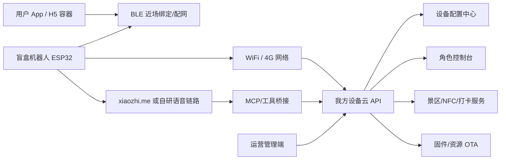

# 商业化 IoT 连接架构参考：类比 usmile 智能电动牙刷

文档状态：draft  
主责智能体：架构师智能体  
更新时间：2026-07-18

## 0. 背景判断

当前联调方式：

```text
电脑与 ESP32 连接同一 WiFi：BusinessCentre-Guest
电脑 WLAN 地址：192.168.101.119
设备 API 地址手动配置为电脑局域网地址
```

该方式只适合实验室、酒店、展会现场的短期联调，不适合商业化。

商业化不能要求用户：

- 电脑和设备必须在同一个 WiFi。
- IP 地址变化后手动重配设备。
- 后端服务跑在某台开发电脑上。
- 设备依赖开发者现场操作。

## 1. usmile 类智能电动牙刷的公开可见模式

公开资料显示，usmile/笑容加智能牙刷的典型模式是：

- 设备带蓝牙能力。
- 手机 App 与智能牙刷配对。
- App 可设置牙刷参数。
- App 汇集刷牙数据并生成口腔健康/刷牙报告。
- 部分型号支持 OTA 在线升级。
- 公开资料提到 App 通过蓝牙连接使用，有效距离约 10-15m。

这类产品的商业化重点不是让用户理解网络 IP，而是：

```text
硬件设备
  -> 手机 App 近场连接
  -> App 做账号、绑定、配置、数据同步
  -> 云端保存用户/设备/数据
  -> 后台做运营、售后、升级和分析
```

## 2. 对本项目的架构启发

我们的设备比牙刷复杂，因为有语音链路、角色智能体、景区知识、GPS/NFC 打卡。

但商业化连接思想类似：

| 类比对象 | 智能牙刷 | 本项目盲盒机器人 |
| --- | --- | --- |
| 设备绑定 | App 绑定牙刷 | App/管理端绑定机器人 |
| 近场连接 | 蓝牙连接牙刷 | BLE 配网/近场绑定，WiFi 连接云端 |
| 参数配置 | 模式、力度、提醒 | 角色、prompt、景区数据、播报策略 |
| 数据同步 | 刷牙时长、力度、区域 | GPS/NFC、打卡、角色互动摘要 |
| 报告展示 | 刷牙报告、健康建议 | 打卡记录、游览报告、角色成长 |
| OTA | 在线升级牙刷 | 固件包、角色资源、能力升级 |
| 云端后台 | 用户数据和设备服务 | 设备云、角色控制台、景区知识库 |

## 3. 商业化推荐架构



## 4. 商业化阶段应替代当前联调方式

### 当前一期联调

```text
设备 -> 酒店/现场 WiFi -> 开发电脑局域网 IP -> Django API
```

问题：

- IP 会变。
- 用户无法配置。
- 网络不可控。
- 设备离开现场即失效。
- 无法批量设备管理。

### 商业化目标

```text
设备 -> 用户网络/蜂窝网络 -> 固定云端域名 -> 设备云 API
App -> 账号登录 -> 绑定设备 -> 配网/配置/数据同步
后台 -> 管理设备、角色、知识库、OTA、售后
```

商业化设备不应保存 `192.168.x.x` 这类开发机地址，而应保存：

- 固定 HTTPS 域名。
- 环境标识，如 `prod`、`staging`。
- 设备 token 或证书。
- 配置版本号。
- 回退服务地址。

## 5. 本项目建议的商业化连接分层

| 层级 | 一期 Demo | 商业化建议 |
| --- | --- | --- |
| 设备发现 | 手动烧录/手动配置 | BLE 广播、扫码、SN 绑定 |
| 配网 | 手工让设备连指定 WiFi | App 引导 WiFi 配网，或 4G 版本 |
| API 地址 | 手填电脑 IP | 固定 HTTPS 域名 + 环境配置 |
| 设备绑定 | 后台演示账号绑定 | 用户 App/工厂后台绑定 |
| 角色配置 | 后端保存，设备拉取 | 配置中心版本化下发 |
| 语音链路 | xiaozhi.me | 先保留，后续可自建语音网关 |
| 数据同步 | 本地/公网 Demo | 云端设备事件队列和数据同步 |
| OTA | 一期不做 | 固件包、资源包、灰度、回滚 |
| 故障处理 | 人工现场排查 | 设备日志、心跳、远程诊断 |

## 6. 最小商业化版本建议

不要一上来做完整自研语音服务端。建议最小商业化版本先做：

1. **固定云端 API 域名**
   - 设备不再指向电脑 IP。
   - 后端部署到云服务器。
   - 使用 HTTPS。

2. **设备绑定与激活**
   - 工厂写入 `device_id` 和初始 token。
   - App/后台完成用户或运营绑定。
   - 支持解绑、换绑、停用。

3. **App/BLE 配网**
   - 手机近场发现设备。
   - 输入 WiFi 或选择网络。
   - 设备拿到网络后连接云端。

4. **设备配置中心**
   - 设备从云端拉取角色、景区、NFC、播报策略。
   - 配置带版本号。
   - 拉取失败使用缓存。

5. **数据同步与报告**
   - 上报打卡、定位质量、设备状态。
   - 用户端展示角色和打卡记录。

6. **OTA 后置但预留字段**
   - 先在设备和后台保存固件版本。
   - 商业化前再做固件包管理、灰度和回滚。

## 7. 对当前工程的改造建议

短期可以继续保留：

- `xiaozhi.me` 语音链路。
- Django/DRF 后端。
- React 管理端。
- 设备模拟器。

但需要新增或明确：

| 能力 | 建议落点 |
| --- | --- |
| 设备激活状态 | `backend/apps/devices` |
| 设备云端 API 域名 | `deploy/.env.example` 和固件配置 |
| 配置版本 | `devices` 或配置聚合接口 |
| BLE 配网方案 | 固件架构文档先定义，后续全栈/固件实现 |
| App/H5 绑定流程 | 产品经理定义交互，全栈实现 |
| 固件版本字段 | `devices` |
| OTA 预留字段 | `devices` + 后续 `firmware_packages` |

## 8. 关键结论

商业化不能继续依赖“同一 WiFi + 电脑局域网 IP”。

建议学习智能牙刷这类消费 IoT 的模式：

```text
手机 App 负责近场绑定/配网/用户体验
云端负责设备、配置、数据、OTA
设备只保存固定云端入口和本地兜底配置
后台负责运营和售后
```

本项目的差异是：我们还多了语音智能体和景区业务，所以应先把设备配置中心、角色控制台、打卡数据云端化做好，再考虑自建语音服务和完整 OTA。
