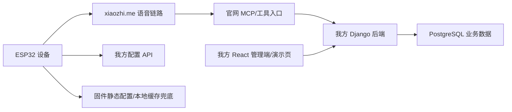

# 小智官网兼容与自研替代双轨架构

文档状态：draft  
主责智能体：架构师智能体  
更新时间：2026-07-13

## 0. 目标

双轨架构的目标是：自研能力可以持续推进，但任何一个自研模块短期失败时，Demo 和设备联调仍能回退到小智官网或固件兜底。



## 1. 双轨定义

| 轨道 | 作用 | 当前边界 |
| --- | --- | --- |
| 官网兼容轨 | 保证语音、设备接入、MCP 入口可用 | `xiaozhi.me` 继续作为不可见依赖 |
| 自研替代轨 | 收回业务主数据、角色配置、景区知识和打卡闭环 | Django/DRF + PostgreSQL + React |
| 兜底轨 | 演示失败时不让体验中断 | 固件静态配置、固定播报、模拟器、手工配置 |

## 2. 运行链路

### 2.1 正常链路

```text
设备启动
  -> 连接小智语音链路
  -> 调用我方配置 API 拉取角色/点位/NFC/数据集摘要
  -> 用户语音交互进入小智链路
  -> 小智工具入口调用我方 context / knowledge 接口
  -> 设备 GPS 接近提醒
  -> NFC 读卡确认打卡
  -> 打卡事件写入我方后端
  -> 我方演示页展示结果
```

### 2.2 小智工具调用失败

```text
工具调用失败
  -> 使用后端预置上下文或固定播报
  -> 演示页仍展示设备/打卡状态
  -> 记录失败日志
  -> 后续由全栈/联调人员排查公网、token、超时
```

### 2.3 我方配置 API 失败

```text
配置拉取失败
  -> 设备使用本地缓存
  -> 无缓存时使用固件静态 Demo 配置
  -> 后端恢复后重新拉取配置
```

### 2.4 官网链路失败

```text
语音链路失败
  -> 不影响我方管理端展示
  -> GPS/NFC 打卡可继续本地记录或模拟
  -> 演示可切到页面演示和固定文案
```

## 3. 架构模块

| 模块 | 所属轨道 | 责任 |
| --- | --- | --- |
| Device Config API | 自研替代轨 | 给设备下发绑定角色、景点、NFC、知识摘要版本 |
| Agent Config API | 自研替代轨 | 管理角色 prompt、voice_id、知识库引用 |
| Knowledge API | 自研替代轨 | 给小智工具或前端查询景区知识 |
| Checkin API | 自研替代轨 | 接收 GPS 接近、NFC 打卡、幂等处理 |
| MCP Tool Bridge | 官网兼容轨 + 自研替代轨 | 官网工具入口调用我方接口 |
| Frontend Console | 自研替代轨 | 展示设备、角色、景点、打卡、数据集状态 |
| Firmware Fallback | 兜底轨 | 静态配置、本地缓存、固定播报 |
| Official Console Manual Config | 官网兼容轨 | 必要时人工维护最少官网配置 |

## 4. 数据主从原则

| 数据 | 主数据方 | 说明 |
| --- | --- | --- |
| 设备业务档案 | 我方后端 | 官网设备 ID 可作为外部引用 |
| 设备语音连接状态 | 官网/官方链路 | 我方可保存摘要，不作为实时音频状态源 |
| 角色 prompt | 我方后端 | 官网只保存必要入口或临时配置 |
| 景区知识 | 我方后端 | 官网不作为知识主库 |
| NFC/打卡 | 我方后端 | 官网不承载 |
| 工具调用日志 | 我方后端 | 至少记录我方接口入口日志 |
| 固件版本 | 过渡期手工/后续我方 | OTA 平台后置 |

## 5. 切换开关

建议后续实现中保留以下配置开关：

| 开关 | 作用 |
| --- | --- |
| `VOICE_PROVIDER=xiaozhi` | 当前语音链路走小智 |
| `CONFIG_SOURCE=backend/static` | 设备配置优先后端，失败走静态 |
| `MCP_TOOL_MODE=official_bridge/local_mock` | 官网工具调用或本地模拟 |
| `CHECKIN_MODE=online/local_buffer` | 打卡在线写入或本地缓存 |
| `KNOWLEDGE_MODE=backend/fixed_script` | 知识库查询或固定播报 |

这些开关不要求一期全部实现，但架构上要预留。

## 6. 验收边界

双轨框架的架构验收标准：

- 不展示小智官网页面也能完成我方演示页展示。
- 小智官网只作为语音和工具入口，不作为景区业务主库。
- 设备角色配置以我方后端为主，允许固件兜底。
- MCP/工具失败时不阻断 GPS/NFC 打卡演示。
- 后续自建语音服务端时，不需要推翻设备、角色、景区和打卡数据模型。

