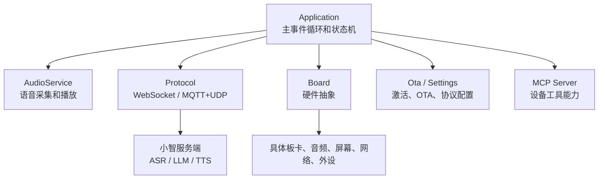
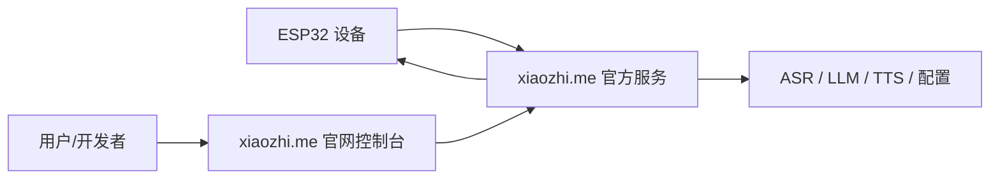
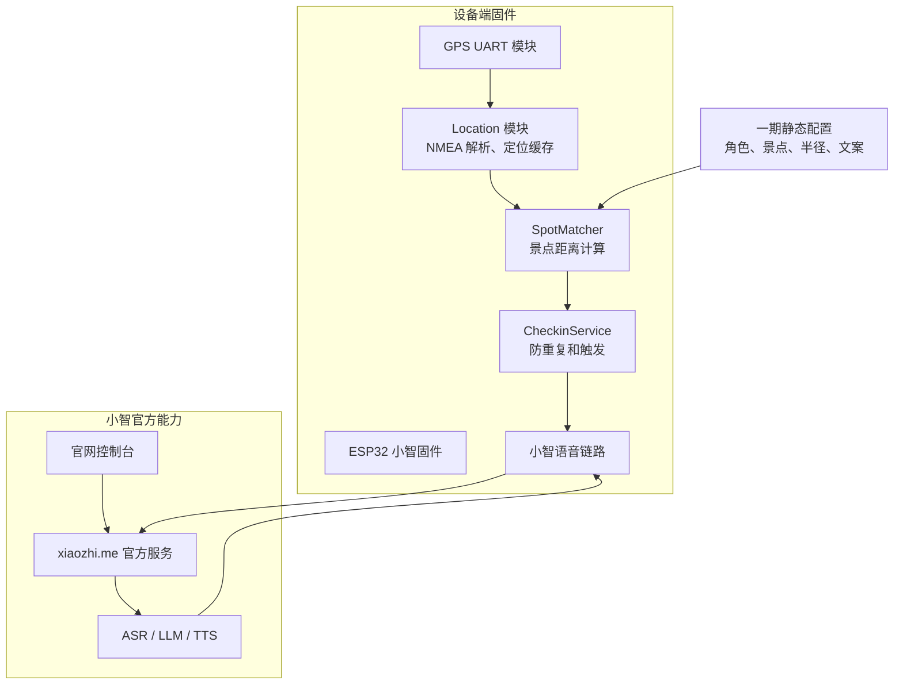
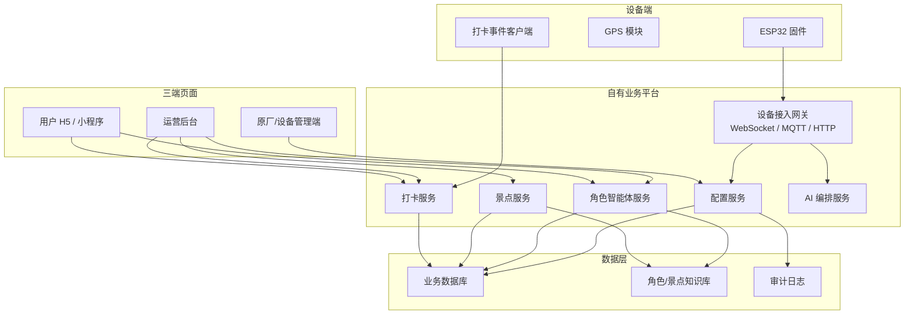
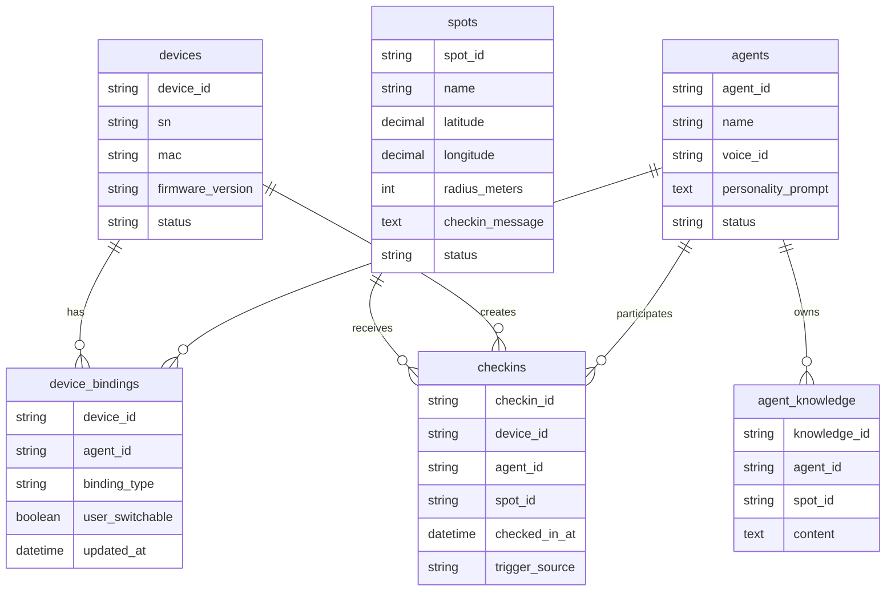
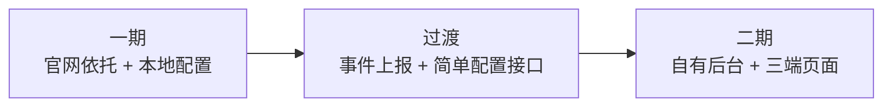

# 盲盒角色智能体旅游打卡项目一期建设文档与二期架构建议

## 1. 文档定位

本文基于当前 `xiaozhi-esp32-main` 固件仓库、产品经理需求文档和项目角色分工文档，给出一期建设范围、二期建设建议和未来整体架构资料。

当前项目本质是基于小智 ESP32 固件进行二次开发。现阶段优先验证“盲盒角色 IP + 语音智能体 + GPS 景点打卡”的最小闭环，而不是直接建设完整商业化平台。

参考资料：

- 本地固件仓库：`xiaozhi-esp32-main`
- 产品需求：`docs/blindbox_agent_tourism_demo_prd.md`
- 项目角色分工：`docs/project_role_agents.md`
- 小智固件开源项目：https://github.com/78/xiaozhi-esp32
- 小智官方平台：https://xiaozhi.me/
- 可参考的自建服务端：https://github.com/xinnan-tech/xiaozhi-esp32-server

## 2. 当前项目现状

### 2.1 当前代码架构

当前仓库是 ESP-IDF/C++ 固件项目，不包含可直接运营的 Web 后台或用户端页面。核心模块如下：



关键边界：

- `Application` 负责初始化、网络事件、主循环、状态切换、协议回调。
- `Board` 负责屏蔽不同 ESP32 板卡、网络、音频、屏幕、外设差异。
- `Protocol` 负责 WebSocket 或 MQTT+UDP 通信。
- `Ota` 当前负责检查版本、激活、写入 MQTT/WebSocket 配置。
- `MCP Server` 负责设备能力发现和工具调用。

### 2.2 当前对官网的依托关系

当前如果不自建服务端，设备默认依托小智官方链路：



当前控制方式不是 Web 页面直连设备，而是：

1. 用户在 `xiaozhi.me` 控制台配置设备、模型、智能体或相关参数。
2. 设备开机联网后请求官方服务，获得激活和协议配置。
3. 设备通过 WebSocket 或 MQTT+UDP 与官方服务交互。
4. 官方服务完成 ASR、LLM、TTS，并把音频和控制消息返回设备。

因此，一期可以依托官网快速验证语音链路，但官网控制台不是我们的景区业务后台，不能完整承载景点、打卡、运营数据和用户侧玩法。

## 3. 产品目标和范围判断

产品经理文档中定义的 P0 闭环包括：

- 设备唯一身份。
- 设备绑定单一角色。
- 角色人设提示词。
- 角色专属音色。
- 角色轻量知识库。
- 景点坐标配置。
- GPS 定位读取。
- 到点判断。
- 防重复触发。
- 到点角色播报。
- 景点后续问答。

本项目当前应采用两阶段推进：

- 一期：依托官网，完成可演示的设备端 GPS 打卡和角色语音闭环。
- 二期：建设自有业务后台和三端页面，沉淀设备、角色、景点和打卡数据。

## 4. 一期建设文档

### 4.1 一期目标

一期目标是完成可演示、可拍摄、可验证用户兴趣的最小闭环。

一句话目标：

> 用户携带一个绑定固定角色的盲盒机器人到达指定景点后，设备能识别到点、避免重复触发，并以角色口吻主动播报和引导问答。

### 4.2 一期系统架构



### 4.3 一期功能范围

P0 必做：

| 模块 | 建设内容 | 说明 |
| --- | --- | --- |
| 设备身份 | 复用现有 UUID / MAC | 当前 `Board` 已有 UUID 和系统信息上报能力 |
| 角色绑定 | 先依托官网控制台或静态配置 | 一期不做自有后台改绑 |
| GPS 读取 | 新增 UART GPS 服务 | 支持标准 NMEA 数据读取 |
| 定位解析 | 解析有效 fix、经纬度、时间 | 无有效 fix 不触发 |
| 景点匹配 | Haversine 距离计算 | 支持 1-3 个固定景点 |
| 防重复 | 本地 NVS 记录或内存冷却 | 同一景点短时间不重复播报 |
| 到点反馈 | 播放提示音、显示状态 | 复用现有音效和显示能力 |
| 角色播报 | 借助小智语音链路 | 一期可由 prompt 或固定文案触发 |
| 验收 Demo | 可录制完整视频 | 证明产品闭环成立 |

P1 可选：

- 打卡事件通过 MCP notification 上报。
- 离线可本地打卡但不做云端记录。
- 简单串口调试命令模拟 GPS 坐标。

一期不做：

- 自有 Web 管理后台。
- 用户 App / 小程序。
- 完整景区地图导航。
- 多景区路线。
- 角色商城。
- 长期记忆。
- 完整数据看板。

### 4.4 一期固件模块建议

建议新增产品层模块，避免污染板卡目录：

```text
main/
  location/
    gps_service.h
    gps_service.cc
    nmea_parser.h
    nmea_parser.cc
    geo_distance.h
    geo_distance.cc
  checkin/
    spot_config.h
    spot_matcher.h
    spot_matcher.cc
    checkin_service.h
    checkin_service.cc
  agent/
    agent_config.h
    agent_context.h
```

模块边界：

- `boards/<board>/config.h` 只定义 GPS UART 引脚、波特率和硬件使能。
- `location` 只负责定位数据，不知道角色和播报。
- `checkin` 只负责景点匹配、防重复和事件生成。
- `agent` 只保存角色 ID、名称、播报风格等轻量上下文。
- `Application` 只做调度和事件接入，不承载景点业务算法。

### 4.5 一期数据结构

一期可先用固件内置或本地 JSON 等价结构：

```json
{
  "agent": {
    "agent_id": "agent_alo",
    "name": "阿洛",
    "voice_id": "voice_alo_01",
    "personality_prompt": "你是一个活泼、好奇、喜欢讲故事的旅游伙伴。"
  },
  "spots": [
    {
      "spot_id": "spot_gate_001",
      "name": "景区入口",
      "latitude": 31.2304,
      "longitude": 121.4737,
      "radius_meters": 50,
      "cooldown_seconds": 3600,
      "checkin_message": "你到啦！这里就是我们今天旅程的第一站。"
    }
  ]
}
```

本地打卡记录：

```json
{
  "spot_id": "spot_gate_001",
  "checked_in_at": "2026-07-10T10:00:00+08:00",
  "agent_id": "agent_alo"
}
```

### 4.6 一期验收标准

| 验收项 | 标准 |
| --- | --- |
| GPS 读取 | 设备能持续读取并解析有效经纬度 |
| 定位有效性 | 无 fix 时不会触发打卡 |
| 到点判断 | 进入指定半径后触发一次打卡 |
| 防重复 | 冷却时间内不重复播报 |
| 角色播报 | 到点后以绑定角色口吻播报 |
| 语音问答 | 播报后用户可继续提问 |
| 官网依托 | 语音链路继续走 `xiaozhi.me` 官方服务 |
| Demo 完整性 | 可完成 3-5 分钟演示视频 |

### 4.7 一期风险和控制

| 风险 | 影响 | 控制策略 |
| --- | --- | --- |
| 官网后台不支持景点业务 | 无法沉淀业务数据 | 一期只验证体验，二期自建后台 |
| GPS 室内或弱信号不稳定 | 误触发或不触发 | 支持坐标模拟和现场半径调参 |
| 角色配置依赖手工 | 多设备管理困难 | 一期接受，二期改为后台配置 |
| 打卡记录只在本地 | 无运营数据 | 二期建设 checkin 表和事件上报 |
| 位置隐私 | 后续合规风险 | 一期不上传连续轨迹，只处理到点事件 |

## 5. 二期建设建议

### 5.1 二期目标

二期目标是从 Demo 走向可运营的业务系统，建立自有后台和三端能力。

一句话目标：

> 将设备、角色、景点、打卡和内容运营收归自有平台管理，并保留小智语音底座能力。

### 5.2 二期推荐架构



### 5.3 二期三端建设

#### 运营后台

面向运营人员和内容配置人员。

核心页面：

- 设备列表：设备 ID、SN、MAC、在线状态、绑定角色、固件版本。
- 角色管理：角色名称、人设 prompt、voice_id、知识库引用、状态。
- 景点管理：景点名称、经纬度、触发半径、讲解文案、启用状态。
- 打卡记录：设备、角色、景点、时间、触发方式。
- 内容管理：景点问答、角色故事、播报模板。

#### 原厂/设备管理端

面向生产、售后和设备运营人员。

核心页面：

- 设备激活。
- 出厂绑定角色。
- 设备改绑角色。
- 固件版本和 OTA 状态。
- 绑定关系审计。

#### 用户端 H5 / 小程序

面向游客或购买用户。

一期之后再做，避免过早拉大范围。

核心页面：

- 当前角色介绍。
- 已打卡景点。
- 景点故事卡片。
- 简单成就或收藏记录。
- 可选设备绑定入口。

### 5.4 二期后端服务建议

推荐优先评估基于 `xinnan-tech/xiaozhi-esp32-server` 扩展，而不是完全重写小智服务端。

原因：

- 已有小智协议、WebSocket、MQTT+UDP、MCP、语音链路相关基础。
- 已有管理后台方向，可减少从零建设成本。
- 更适合从官方依托迁移到私有化运营。

如果自研后端，建议拆分为：

| 服务 | 职责 |
| --- | --- |
| Device Config Service | 设备身份、绑定角色、设备配置下发 |
| Agent Service | 角色 prompt、voice_id、知识库、内容边界 |
| Spot Service | 景点配置、半径、文案、景点知识 |
| Checkin Service | 打卡事件接收、去重、记录、统计 |
| AI Orchestrator | ASR/LLM/TTS 编排，注入角色和景点上下文 |
| Admin API | 后台管理端 API |

### 5.5 二期核心数据模型



### 5.6 二期设备到后台契约

设备配置拉取：

```http
GET /api/device-config?device_id={device_id}
```

响应：

```json
{
  "device_id": "device_001",
  "agent": {
    "agent_id": "agent_alo",
    "name": "阿洛",
    "voice_id": "voice_alo_01",
    "personality_prompt": "你是一个活泼、好奇、喜欢讲故事的旅游伙伴。"
  },
  "spots": [
    {
      "spot_id": "spot_gate_001",
      "name": "景区入口",
      "latitude": 31.2304,
      "longitude": 121.4737,
      "radius_meters": 50,
      "cooldown_seconds": 3600
    }
  ]
}
```

打卡事件上报：

```http
POST /api/checkins
```

请求：

```json
{
  "device_id": "device_001",
  "agent_id": "agent_alo",
  "spot_id": "spot_gate_001",
  "event_time": "2026-07-10T10:00:00+08:00",
  "location_quality": {
    "fix": true,
    "satellites": 8,
    "hdop": 1.2
  }
}
```

响应：

```json
{
  "accepted": true,
  "checkin_id": "checkin_001",
  "speak_text": "你到啦！这里就是我们今天旅程的第一站。",
  "next_action": "start_spot_qa"
}
```

隐私原则：

- 默认不上报连续轨迹。
- 打卡事件中不保留高频经纬度轨迹。
- 日志中不打印完整 token、用户语音原文和敏感位置明细。

## 6. 一期到二期迁移路径



迁移步骤：

1. 一期先让 GPS、到点判断、防重复、角色播报在设备端跑通。
2. 增加打卡事件上报能力，但仍可继续使用官网语音链路。
3. 建设自有配置 API，替代固件静态景点配置。
4. 建设运营后台，维护设备、角色、景点和打卡记录。
5. 评估迁移到自建小智服务端或继续混合使用官方语音链路。

## 7. 质量门和验收建议

### 一期质量门

- GPS 模块在目标硬件上能稳定读取。
- 无定位 fix 时不会触发。
- 景点半径可调。
- 防重复逻辑可验证。
- 官网语音链路可稳定完成播报和问答。
- Demo 环境有坐标模拟或现场测试方案。

### 二期质量门

- 设备、角色、景点、打卡数据权责清晰。
- 后台具备权限控制和审计。
- 打卡事件可幂等处理，避免重复写入。
- 设备配置有版本号和回滚方案。
- 位置数据有隐私策略。
- 服务端有基本日志、健康检查和备份策略。

## 8. 关键问题清单

需要在一期开始前确认：

- 目标硬件板卡型号。
- GPS 模块型号、UART 引脚、电平、天线方案。
- Demo 景点数量和坐标。
- 打卡半径初始值。
- 一期角色数量和角色 prompt。
- 是否允许一期完全依托 `xiaozhi.me` 官方服务。

需要在二期启动前确认：

- 是否采用 `xinnan-tech/xiaozhi-esp32-server` 作为私有化基座。
- 三端优先级：运营后台、原厂管理端、用户 H5 哪个先做。
- 用户是否需要账号体系。
- 打卡数据是否需要对用户展示。
- 是否需要保留官网链路作为备选。
- 位置和对话数据的保存周期。

## 9. 架构决策建议

### ADR-001：一期依托官网，二期建设自有后台

Context:

当前固件仓库不包含 Web 后台，小智官方平台已提供语音服务和控制台，产品当前需要快速验证 Demo。

Options:

- 直接自建完整平台。
- 一期依托官网，二期自建业务后台。
- 完全长期依赖官网。

Decision:

选择“一期依托官网，二期自建业务后台”。

Consequences:

- 一期交付最快，语音链路风险最低。
- 一期业务数据沉淀有限。
- 二期需要补后台、三端、数据模型和设备配置下发。

Migration / rollback:

- 一期保留设备端本地配置和官网链路。
- 二期逐步将角色、景点、打卡配置迁移到自有后台。
- 如自建服务端不稳定，可继续回退到官网语音链路做演示。

### ADR-002：GPS 和打卡逻辑放在产品层模块，不写进板卡文件

Context:

项目已支持大量板卡，板卡目录应只处理硬件差异。景点、角色和打卡属于产品业务。

Options:

- 在具体板卡文件中直接写 GPS 和打卡逻辑。
- 新增 `location`、`checkin`、`agent` 产品层模块。

Decision:

选择新增产品层模块。

Consequences:

- 后续更换板卡成本低。
- 业务逻辑可测试、可迁移。
- 初期需要增加少量模块设计。

Migration / rollback:

- 板卡只暴露 UART 配置。
- 如一期时间紧，可先最小实现，但目录结构仍按产品层划分。

### ADR-003：默认只上报打卡事件，不上传连续轨迹

Context:

GPS 定位涉及位置隐私，Demo 阶段目标是验证到点触发，不需要连续轨迹。

Options:

- 上传连续位置。
- 只上传打卡事件。
- 完全不上报，只本地记录。

Decision:

一期默认本地记录，二期只上报打卡事件。

Consequences:

- 隐私风险更低。
- 无法做实时地图轨迹。
- 足够支撑景点打卡 Demo 和基础运营。

Migration / rollback:

- 如未来要做导航或轨迹，需要单独做用户授权和数据治理设计。

